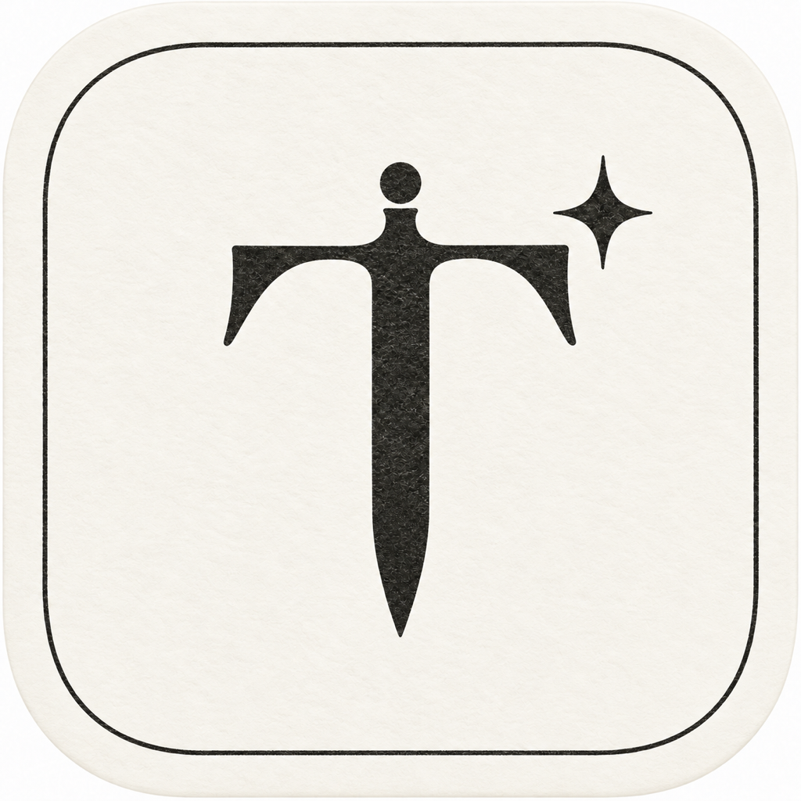
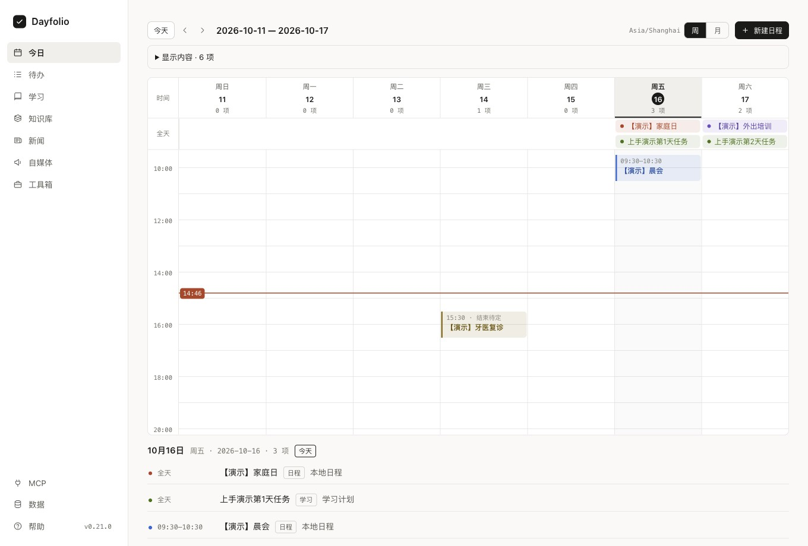
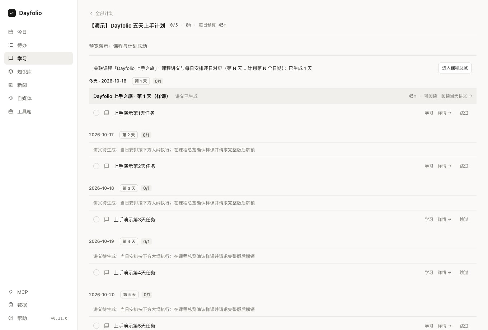

# Dayfolio

**让今天有安排，让学习有积累。**

本地优先、支持 AI 协作的 macOS 个人工作台。 
把待办、日程、学习、知识和创作，放进同一个日常空间。

[功能一览](#一个工作台串起你的日常) · [开始使用](#开始使用) · [使用指南](apps/help/docs/00-quickstart.md) · [更新记录](CHANGELOG.md) · [反馈建议](https://github.com/ganlinzhen/Dayfolio/issues)

 

真实 App 界面 · 隔离演示数据

## 为什么选择 Dayfolio

每天要处理的事情，往往散落在待办、日历、课程、笔记和聊天窗口里。Dayfolio 把它们连接起来：打开 App 看清今天的安排，让 AI 帮你整理与推进，再把过程留下来。

- **从安排到行动，少搬运一次。** 学习计划拆成每天的任务，关联待办与课程讲义；到期的学习和日程都能在「今日」查看。
- **AI 帮你做事，结果留在工作台。** 接入你常用的 AI 助手后，用自然语言记录待办、制定学习计划、整理新闻、制作小工具，回到 App 就能查看和继续处理。
- **个人数据留在本机。** 使用 App 无需注册 Dayfolio 账号，日常数据保存在自己的 Mac；接入 AI 时，相关内容会交由你选择的客户端处理。
- **工作台可以随你生长。** 加入自己的小工具和数据类型，把读书记录、项目清单等个人需求收进同一个空间。

## 一个工作台，串起你的日常

### 看清今天，也安排好接下来

打开「今日」，用周视图查看时间安排，也能切换月视图浏览更长周期。待办支持优先级、标签、日期和时间段；完成后留下记录，随时回看做过的事。

临时想到一件事？从 Mac 菜单栏快速记下，继续手头的工作。

### 把“想学”变成每天能推进的计划

告诉 AI 你想学什么、每天有多少时间，先看计划草案，确认后再开始。每天的学习、复习、练习与讲义相互关联，跟着当天的安排往前走。

学习记录和测评帮助你回顾薄弱点，调整后续安排；完成进度与掌握情况分开展示。值得留下的收获，还可以整理成待审知识卡片。

### 让信息、知识与创作接得上

| 你想做的事 | Dayfolio 可以帮你 |
| --- | --- |
| 了解关心领域的新进展 | 创建新闻任务，让 AI 搜索核实后整理摘要与原始来源；在 App 里阅读、收藏和回看。 |
| 找回以前记过的知识 | 接入 Obsidian 知识库，搜索笔记、浏览正文与双向链接，并关联学习概念；原笔记保持只读。 |
| 把一个想法写成多平台内容 | 从选题、素材和母稿，到不同平台版本、人工审核、发布排期与复盘，集中管理创作过程。 |
| 留住顺手的小工具 | 将倒计时、计算器、格式转换等网页小工具放进工具箱，在 App 内直接打开；也可以请 AI 帮你制作。 |
| 管理自己的独特需求 | 在「数据」中增加自定义类型和关联，例如读书记录、项目资料，让个人工作台更贴合自己的习惯。 |

新闻需要 AI 助手执行采集；内容创作由你审核并在外部平台手动发布。App 中会保留任务进度与处理记录，方便继续推进。

## 开始使用

### 1. 在 Mac 上运行 Dayfolio

目前公开发布提供源码，**尚未提供可直接下载安装的桌面安装包**。首次体验请按[本机运行与演示指引](apps/help/docs/14-isolated-preview.md)准备环境并启动；演示模式自带示例内容，退出后清理临时数据，适合先试用。

已安装的用户可直接打开 Dayfolio。支持情况和后续安装包请以[发布页面](https://github.com/ganlinzhen/Dayfolio/releases)为准。

### 2. 记下第一件事

进入「待办」，填入一件今天要做的事，选好安排日期和时间；暂时没有具体时间，可选「仅日期」。保存后回到「今日」查看安排，完成时勾选即可。

### 3. 让 AI 加入你的日常

如果希望 AI 帮忙，进入 App 左下角「MCP」，按[AI 助手接入指南](apps/help/docs/08-mcp.md)连接兼容的客户端。完成接入后，在你的 AI 客户端里试着说：

> 帮我记一条待办：周五前交报告，优先级高。

> 我想学线性代数，每天 1 小时。先给我一份两周学习计划草案。

> 帮我整理最近 24 小时的 AI 新闻，保留原始来源链接。

> 做一个番茄钟小工具，放进我的工具箱。

AI 协作通过外部客户端进行。App 负责展示、管理与必要的人工确认；学习课程先阅读样课，再由你确认继续生成。

### 4. 按自己的节奏扩展

先用好「今日」和「待办」，再按需加入学习、知识库、新闻和创作。每个模块的说明都可以在 App 左下角「帮助」中找到。

## 使用前，你可能想知道

**一定要连接 AI 吗？**

不用。待办、日历和已有内容的查看管理可以直接使用；学习计划生成、新闻采集和 AI 制作工具等功能需要接入 AI 助手。

**需要注册账号或付费吗？**

Dayfolio 以 MIT 许可开源，无需注册 Dayfolio 账号。若使用第三方 AI 客户端或模型，其账号、费用和数据处理规则由对应服务决定。

**离线能用吗？**

本地待办、日程和已保存的内容可以离线使用。AI 搜索、内容生成，以及小工具自身依赖的联网功能需要相应网络服务。

**支持哪些设备？**

目前桌面端面向 macOS。Windows、Linux、手机端及跨设备同步尚未提供经过验收的使用方案。

**从 TodoDesk 或「日序 Dayfolio」升级会丢数据吗？**

这些都是项目的曾用名，现统一为 Dayfolio；已有数据位置与 AI 接入标识继续兼容。升级前建议备份自己的数据与课程、工具资产。

## 继续了解与参与

- [快速上手](apps/help/docs/00-quickstart.md)：了解导航、日常使用节奏与各模块入口。
- [学习闭环](apps/help/docs/09-study-loop.md)：从计划、课程到复习与知识卡片。
- [工具箱](apps/help/docs/06-toolbox.md)：加入自己的小工具。
- [更新记录](CHANGELOG.md)：查看每个版本的变化。
- [报告问题或提出建议](https://github.com/ganlinzhen/Dayfolio/issues/new/choose)：附上使用场景，帮助 Dayfolio 变得更好。

喜欢这个项目，欢迎 Star、分享使用体验，或通过 Pull Request 参与改进。

---

[MIT 开源许可](LICENSE) · 教学技能的上游许可见[对应说明](packages/agent-kit/skills/tododesk-teach/LICENSE)。
