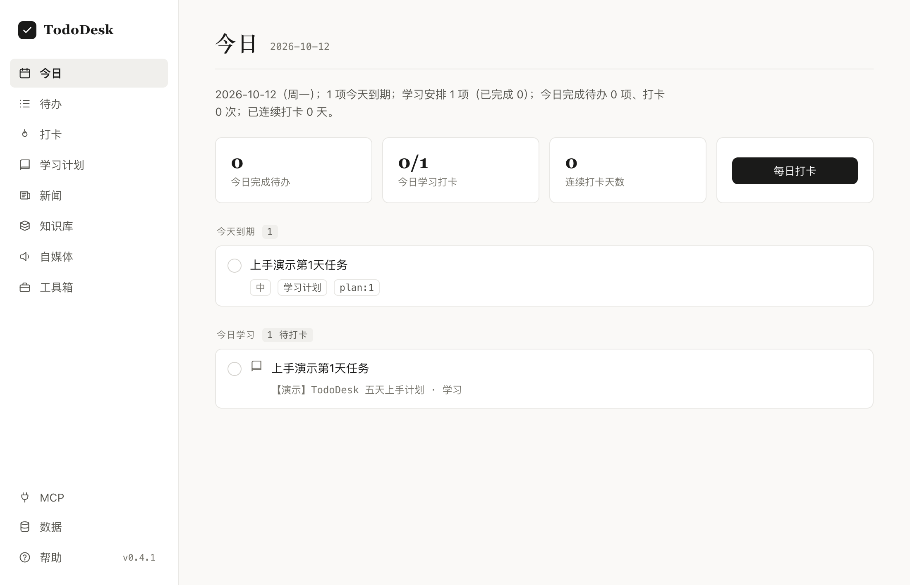

# TodoDesk

面向个人的 macOS 桌面助手：待办、学习计划、课程、打卡、新闻任务、知识库浏览与 HTML 工具箱。内置 MCP Server，让支持 MCP 的 AI 客户端与桌面应用读写同一份本地数据。

仓库：[ganlinzhen/vibe-ai](https://github.com/ganlinzhen/vibe-ai)。仓库名为 `vibe-ai`，应用名为 **TodoDesk**。



## 环境要求

- macOS；当前桌面打包脚本仅支持 macOS，产物架构与构建机器一致，尚未验收 Windows / Linux 桌面版。
- Node **22.13+ 或 24.x**（推荐 24.x，`.nvmrc` 指向 24）；MCP 与测试依赖内置 `node:sqlite`，Node 20 不受支持。
- npm、Git、Xcode Command Line Tools（`xcode-select --install`，用于原生模块重建）。
- 首次安装需要联网下载依赖及 Electron。

## 功能

- **待办事项**：优先级（高/中/低）、截止日期、标签、备注；过期高亮、筛选排序、行内编辑；来源标记（App 创建 ✍️ / AI 创建 🤖 / 计划生成 📚）
- **学习计划**：按日期编排"学习/复习/练习/休息"条目，自动生成关联待办，逐条打卡，进度条
- **学习闭环**：对 AI 说「学习线性代数」——agent 按内置规范出**草案**（App 内确认/取消）→ 逐日学习**会话**记录 → **测评证据**（自评可纠正/客观必须带判题依据）→ **掌握度**（与打卡完成率分开，无证据=未知）→ 依据漏做与薄弱**调整**未完成安排（预览→确认）→ 生成 Obsidian **待审卡片**（防重、不覆盖人工编辑）。规范经 MCP `get_study_workflow` / 资源 `tododesk://study/workflow` 与帮助面板同源分发
- **间隔复习**：学完知识点一键按遗忘曲线（D+1/3/7/21）生成复习计划与待办（`create_review_schedule`）
- **打卡**：完成待办、完成计划条目、每日打卡均计入；连续天数（streak）、近 7/30 天活跃统计
- **菜单栏常驻**：Tray 显示今日该做数量（逾期加 `!` 前缀提醒）；菜单含今日概览、每日打卡、打开主窗口；菜单「快速捕获…」呼出速记窗（回车入库，`!` 前缀设高优先级）
- **每日新闻（agent-only）**：阅读优先三栏工作台（任务导航/紧凑列表/详情）；**App 不抓 RSS、不配置新闻源或凭证、无任何定时抓取**。任务可由用户在面板「新建任务」发起（主题/规则/上限/时间窗，与 MCP 同一 core 硬校验）或让 AI 助手创建；执行由助手经 MCP：认领 → 自行搜索核实 → 提交带原始来源链接与摘要的条目；每任务累计最多 10 条新入库（跨批次不重置），按事件去重；默认看近 24 小时、可切历史；旧新闻与收藏全部保留；离线时任务保持待执行（App 不自动唤醒助手）
- **帮助中心**：侧边栏底部「帮助」查看各模块使用说明；内容由独立子项目 `apps/help/` 维护，构建时同步进渲染层
- **MCP 接入**：AI 可完成上述全部操作、跑通学习闭环、执行新闻任务（搜索核实后提交）、管理本体（对象/链接/动作类型）与工具箱（把 HTML 小工具装进 App）

## 目录结构

```
tododesk/
├── packages/core/        # 共享核心层：SQLite 数据模型 + 待办/计划/打卡服务（App 与 MCP 复用）
├── apps/desktop/         # Electron 桌面端（React + Vite 渲染层，esbuild 主进程）
├── apps/mcp/             # MCP Server（stdio），构建产物 dist/mcp-server.cjs
├── apps/help/            # 帮助中心子项目：docs/ 一个模块一篇使用说明，npm run help:sync 同步进 App
├── apps/plugin/          # 教学技能、双宿主配置与内置 MCP 构建产物
└── scripts/              # 干净环境验收
```

## 快速开始

```bash
git clone https://github.com/ganlinzhen/vibe-ai.git
cd vibe-ai
nvm use                   # 使用 nvm 时执行；其他安装方式需自行确认 Node 版本
npm ci
npm run build:desktop     # 重建原生模块 + 同步帮助 + 构建渲染层、主进程与预加载
npm start                 # 启动 App
```

开发热更新：`npm run dev`。首次运行前仍需执行 `npm run build:desktop`。

体验演示数据：`node apps/desktop/scripts/preview-isolated.mjs`。它使用一次性临时数据库、HOME 和用户数据，退出后自动清理，适合试用时保留自己的真实数据。

## 桌面打包

```bash
npm run package:desktop
```

产物为 `apps/desktop/release/TodoDesk.app`。脚本采用 ad-hoc 签名，**未做 Developer ID 签名与 Apple 公证**；该产物用于本地构建验收，不代表已提供面向所有 Mac 的正式发行包。打包不会自动安装或替换现有 App。已安装用户更新前应退出应用并备份数据库、课程和工具资产；不要绕过系统签名警告。


数据库位置：`~/Library/Application Support/tododesk/tododesk.db`（可用环境变量 `TODODESK_DB` 覆盖，App 与 MCP 必须指向同一文件）。

## 测试

```bash
npm test        # 全部：核心层单测 + MCP 端到端（真实 stdio 协议拉起子进程）
npm run typecheck
npm run plugin:build
npm run plugin:verify
npm run verify:clean      # macOS：从当前待交付源码创建干净副本，完整验收
```

测试使用临时数据库。两个需要私人旧库快照的迁移用例默认跳过，不影响公开环境的基础验收。`verify:clean` 不复制 `node_modules`、个人 MCP 配置、运行时数据或旧桌面构建产物；日志与 SHA-256 清单写入临时验收目录，不执行 Git 提交或推送。

## 接入 MCP

先在仓库根目录执行 `npm run build:mcp`，生成 `apps/mcp/dist/mcp-server.cjs`。单独使用 MCP 时不需要桌面端构建，也不需要 Electron 原生模块重建。

在支持 MCP stdio 的客户端添加以下服务器配置。zcode 的用户配置位置是 `~/.zcode/cli/config.json`，其他客户端按其说明配置：

```json
{
  "mcpServers": {
    "tododesk": {
      "type": "stdio",
      "command": "node",
      "args": ["/path/to/tododesk/apps/mcp/dist/mcp-server.cjs"]
    }
  }
}
```

> 注意：若修改过数据库位置，App 与 MCP 需通过 `TODODESK_DB` 指向同一文件。

将 `args` 替换为构建产物的实际绝对路径。如果客户端找不到受支持版本的 Node，将 `command` 改为 Node 可执行文件的绝对路径。源码安装不会自动注册 MCP。

教学插件位于 `apps/plugin/`。分发前执行 `npm run plugin:build`、`npm run plugin:verify`；保留包内 `mcp.json`、`.mcp.json` 与 `.zcode-plugin/plugin.json`。宿主需支持对应插件格式，具体安装入口以宿主说明为准。

之后即可对 AI 说，例如：

- 「帮我看下现在有哪些待办」→ `list_todos`
- 「加一条高优先级待办：周五前交报告」→ `add_todo`
- 「把这个任务加到今日待办」→ `add_todo`（`due_date: "今天"`，日期参数支持 today/明天 等别名）
- 「把 ~/Downloads/色板.html 加到工具箱」→ `add_tool`（`file_paths`）
- 「帮我写个倒计时小工具放进工具箱」→ `add_tool`（`files` 传 base64，现场生成无需落盘）
- 「我为《TypeScript 全面指南》这门 20 集的课做个 14 天学习计划，每天 1 小时，注意安排复习」→ `create_study_plan`
- 「今天的学习任务打卡了吗？」→ `get_today` / `update_plan_item`

### MCP 工具一览

| 工具 | 说明 |
| --- | --- |
| `list_todos` / `add_todo` / `update_todo` / `complete_todo` / `delete_todo` | 待办增删改查、完成 |
| `create_study_plan` / `list_study_plans` / `get_study_plan` / `update_study_plan` / `delete_study_plan` | 学习计划管理与进度 |
| `update_plan_item` | 计划条目打卡（done/pending/skipped） |
| `checkin` | 每日打卡 / 对待办或计划条目打卡 |
| `get_today` | 今日概览（逾期、今日安排、打卡状态、连续天数） |
| `get_checkin_stats` | 打卡统计与最近记录 |
| `create_review_schedule` | 间隔复习：按遗忘曲线批量生成复习计划与待办 |
| `list_news` | 库内查询新闻（任务/来源/未读/收藏筛选、关键词、24h 时间窗；只读不联网） |
| `create_news_task` / `list_news_tasks` / `cancel_news_task` | 新闻任务：创建（规则+预算+时间窗）/ 查看进度 / 取消（需用户同意） |
| `claim_news_task` / `submit_news_items` / `complete_news_task` / `release_news_task` | 认领（30 分钟租约）→ 核实后提交（原始来源链接+摘要+真实发布时间；硬校验去重与预算）→ 完成/释放 |
| `mark_news_read` / `mark_news_starred` / `mark_all_news_read` | 已读/收藏状态（与 App 共享） |
| `list_tools` / `add_tool` / `update_tool` / `delete_tool` | 工具箱管理：AI 可把本地 HTML 文件（file_paths）或现场生成的页面（files base64）装入工具箱，App 内即时可见 |
| `list_tool_categories` / `add_tool_category` / `rename_tool_category` / `delete_tool_category` | 工具箱分类管理 |
| `list_object_types` / `query_objects` / `get_object` | 本体数据字典与任意类型的实例查询/详情 |
| `create_object` / `update_object` / `delete_object` | 任意类型（含自定义类型）的实例增删改 |
| `create_object_type` / `update_object_type` / `delete_object_type` | 对象类型管理（动态建表/加列） |
| `create_link_type` / `delete_link_type` | 链接类型管理（类型间关系） |
| `create_action_type` / `update_action_type` / `delete_action_type` / `invoke_action` | 动作类型管理与执行（单事务） |

## 每日新闻（agent-only，无本地抓取）

本地不提供任何抓取命令或定时任务。新闻生产的唯一入口是新闻任务，发起两条路：**App 新闻面板「新建任务」**（用户亲手填主题/规则，走同一 core 硬校验，创建后即见「待执行」），或**对 AI 助手说**「帮我收集某方面最近 24 小时的新闻」。执行一律由助手经 MCP：`claim_news_task` → 用自己的搜索工具核实 → `submit_news_items` 提交（硬校验：来源链接/发布时间/事件去重/每任务累计 10 条预算）。离线时任务保持待执行（App 不自动唤醒助手），下次会话认领接力。

## 技术栈

Electron + React 19 + TypeScript + Vite（渲染层）/ esbuild（主进程）+ SQLite（App 侧 better-sqlite3，MCP 侧 Node 内置 node:sqlite，WAL 模式多进程共享）+ @modelcontextprotocol/sdk。具体依赖版本见各 `package.json` 与根目录锁文件。

产品定位与界面约定见 `PRODUCT.md`、`DESIGN.md`；各模块说明见 `apps/help/docs/`。个人开发笔记位于仓库外，不是构建依赖。

## 许可与数据

源码按 [MIT](LICENSE) 许可发布。教学技能保留了上游来源与许可，见 `apps/plugin/skills/tododesk-teach/LICENSE`；第三方依赖遵循各自许可证。

待办、课程、工具资产与知识库索引保存在本机。MCP 客户端可读取或修改业务数据，接入前应了解所用客户端的数据处理方式。新闻由 AI 客户端联网搜索后提交；源码不包含个人数据库、课程素材或 API 凭证。
