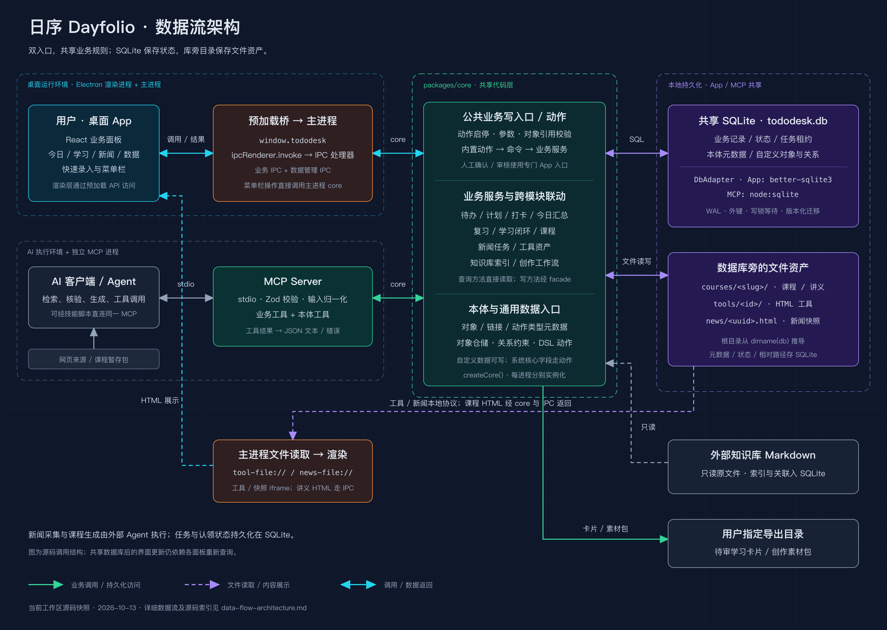
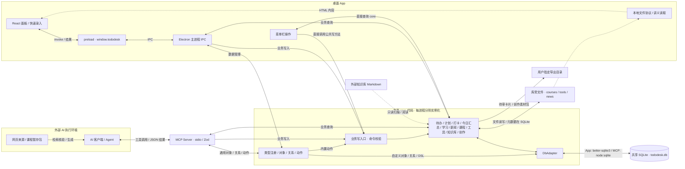
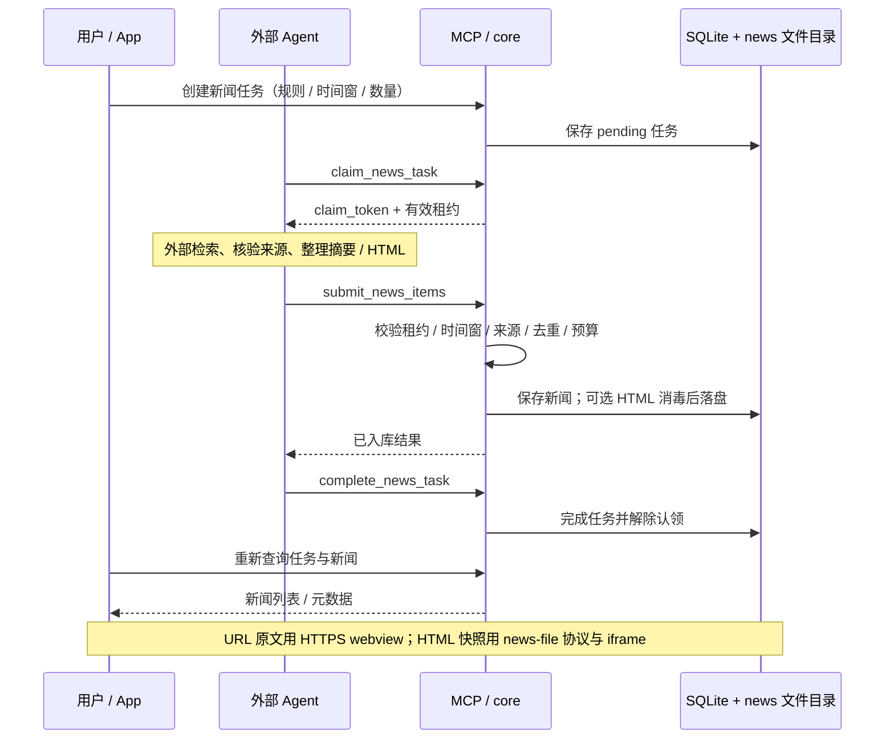

# Dayfolio 当前项目数据流架构

核对日期：2026-10-13（北京时间）。依据：当前工作区源码，包含未提交改动；仓库根 `package.json` 当前版本为 `0.13.0`。这是一份源码结构快照，不表示已安装 App 或已构建 MCP 包与工作区完全一致。

## 整体架构

Dayfolio 是以本地数据为中心的桌面应用。用户通过 Electron App 操作，AI Agent 通过 MCP 工具操作；两条入口复用 `packages/core` 的业务规则，分别建立数据库连接，访问同一份 SQLite 文件。课程、工具和新闻快照以文件形式保存，数据库记录元数据、状态和相对路径。

[查看可编辑 SVG](data-flow-architecture.svg)

图中的 core 表示共享代码层：Electron 主进程与 MCP 进程分别调用 `createCore()` 创建实例，不是两个进程之间的常驻 API 服务。实线表示业务调用或持久化访问，虚线表示文件内容读取和展示；双向箭头表示查询结果或调用结果沿原路径返回。

以下 Mermaid 源码便于后续修改结构；SVG 与 PNG 是独立维护的发布图，更新时需保持一致。

## 入口与职责

| 层 | 职责 | 源码入口 |
| --- | --- | --- |
| React 渲染层 | 面板交互、发起查询、展示结果；通过预加载 API 访问业务能力 | [App.tsx](../apps/desktop/src/renderer/src/App.tsx)、[api.ts](../apps/desktop/src/renderer/src/api.ts) |
| 预加载桥 | 通过 `contextBridge` 暴露 `window.tododesk`，调用 `ipcRenderer.invoke()` | [preload/index.ts](../apps/desktop/src/preload/index.ts) |
| Electron 主进程 | 注册业务 IPC、数据管理 IPC、本地文件协议和菜单栏；IPC 返回 `{ ok, data, error }` | [main/index.ts](../apps/desktop/src/main/index.ts)、[ipc.ts](../apps/desktop/src/main/ipc.ts)、[data-ipc.ts](../apps/desktop/src/main/data-ipc.ts)、[tray.ts](../apps/desktop/src/main/tray.ts) |
| MCP Server | stdio 工具接口、Zod 输入校验、日期等输入归一化；调用 core 后把结果包装成 JSON 文本或错误结果 | [server.ts](../apps/mcp/src/server.ts) |
| 共享 core | 初始化数据库与迁移，组装业务服务、本体、公共命令和关系服务 | [core/index.ts](../packages/core/src/index.ts) |
| 业务服务 | 待办、计划、打卡、今日汇总、间隔复习、学习闭环、新闻、课程、工具、知识库、创作 | [services/](../packages/core/src/services/) |
| 本体与命令 | 类型元数据、对象查询、关系管理、业务命令校验、内置动作和自定义 DSL | [ontology/](../packages/core/src/ontology/) |
| 数据访问 | 统一 `DbAdapter`；App 使用 `better-sqlite3`，MCP 使用 Node 内置 `node:sqlite` | [db.ts](../packages/core/src/db.ts)、[App 数据库适配](../apps/desktop/src/main/db.ts)、[Node 数据库适配](../packages/core/src/adapters/node-sqlite.ts) |

未注册 MCP 的 AI 客户端可使用 [技能直连脚本](../.agents/skills/tododesk/scripts/tododesk.mjs) 启动构建后的 MCP Server，通过同一条 stdio 工具链调用；插件中也携带 MCP 构建产物。这里的工具接口并非 HTTP 服务。

## 主要数据流

### 1. 桌面操作与查询

1. React 面板调用 `window.tododesk.<模块>.<方法>()`。
2. preload 将请求转为 IPC，主进程调用对应 core 服务。
3. 公共业务写方法经 `commands.wrap()` 校验动作启停、参数和对象引用，再执行业务服务；只读方法直接查询服务。
4. 服务通过 `DbAdapter` 查询或更新 SQLite，需要文件的模块同时操作受控文件目录。
5. 主进程返回结果，React 更新视图。菜单栏打卡直接调用主进程中的 core；快速录入窗口通过相同 preload/IPC 保存待办。

MCP 对数据库的写入对后续 App 查询可见，但数据库共享不等于界面实时推送。目前新闻面板在窗口重新获得焦点时刷新，菜单栏定时刷新，其他面板按自身加载与操作逻辑重新查询。

### 2. Agent 工具调用

1. AI 客户端通过 stdio 调用 MCP 工具。
2. MCP 校验并归一化输入，调用与 App 相同的 core 业务接口或本体接口。
3. core 落库或读回数据；MCP 以 JSON 文本返回，客户端继续后续流程。

App 与 MCP 需使用相同的 `TODODESK_DB`（或相同默认路径）。每个进程持有各自的数据库连接和 core 实例，共享 SQLite 文件与库旁资产。

### 3. 学习计划、待办与打卡联动

- 学习草案经排期与确认形成正式计划、计划条目和关联待办。
- 完成计划条目时，core 联动关联待办并记录计划条目打卡；完成待办时按业务规则记录待办打卡。
- 撤销完成会解除对应打卡；公共命令与事务维护跨模块状态的一致性。
- 学习会话、测评和掌握度用于调整建议与学习卡片预览；导出的待审卡片保存到用户指定目录，并记录导出信息。
- 今日概览聚合计划、待办与打卡数据，不是另一份独立业务数据库。

对应源码：[core 组装与联动](../packages/core/src/index.ts)、[plan.ts](../packages/core/src/services/plan.ts)、[study.ts](../packages/core/src/services/study.ts)、[today.ts](../packages/core/src/services/today.ts)。

### 4. 新闻任务与阅读

当前新闻模式是 Agent 提交：抓取与核验发生在外部执行环境，App 与 MCP Server 本身不运行 RSS/X 抓取器。旧新闻来源、话题和同步表保留作历史兼容，不能据此推断当前仍有内置抓取链路。

新闻 HTML 保存在 `news/<uuid>.html`，数据库保存 `content_kind` 与 `html_rel`。删除新闻会保留去重指纹，阻止相同来源链接或同事件再次提交。MCP 提供 `read_news_html` 回读快照。

对应源码：[news.ts](../packages/core/src/services/news.ts)、[news-store.ts](../apps/desktop/src/main/news-store.ts)、[NewsPanel.tsx](../apps/desktop/src/renderer/src/components/NewsPanel.tsx)。图描述已实现的读取路径；本次没有验证已安装 App 中各来源页面或快照的实际显示效果。

### 5. 课程与工具文件

- 课程包由外部流程生成到暂存目录，`import_course` 验证 `course.json` 与讲义内容，将课程资产保存到库旁 `courses/<slug>/`，将课程、讲义、阅读和答题状态写入数据库。讲义 HTML 经 core 读取，通过 IPC 返回渲染层。
- 样课人工确认通过专门的 App 入口执行；后续课程生成请求存入 SQLite，由 Agent 认领、补齐课程包、导入并完成请求。SQLite 请求队列不会自行启动外部 Agent。
- 工具由 App 选择文件或 Agent 提交文件，经公共工具资产服务保存到 `tools/<id>/`。桌面端通过 `tool-file://t/<id>/<相对路径>` 读取并展示 HTML。
- 工具和课程文件操作采用暂存、替换与失败恢复逻辑，配合数据库事务维护元数据与资产；这不等同于 SQLite 事务能自动回滚所有文件系统操作。

对应源码：[course.ts](../packages/core/src/services/course.ts)、[tool-assets.ts](../packages/core/src/services/tool-assets.ts)、[tools-store.ts](../apps/desktop/src/main/tools-store.ts)。

### 6. 知识库与创作

- 注册的外部知识库 Markdown 由 vault 服务只读扫描。解析的笔记索引、元数据和概念关联写入 SQLite；阅读时读取原文件，原知识库文件不由该服务修改。
- 创作服务在 SQLite 保存选题、母稿、平台版本、素材、排期与指标。素材可引用新闻或知识笔记，导出时写入用户指定的素材包目录。
- 创作版本人工审核走专门的 App 入口。当前创作服务管理内容与发布记录，外部平台发布由其他执行流程完成。

对应源码：[vault.ts](../packages/core/src/services/vault.ts)、[media.ts](../packages/core/src/services/media.ts)。

## 存储与一致性边界

| 存储 | 主要内容 | 访问方式 |
| --- | --- | --- |
| `tododesk.db` | 业务记录、状态、任务认领、本体元数据、自定义对象与关系 | App 与 MCP 分别经 `DbAdapter` 读写 |
| `dirname(db)/courses/<slug>/` | 课程包、讲义及资产 | core 导入与读取，讲义内容经 IPC 返回 |
| `dirname(db)/tools/<id>/` | HTML 小工具及配套文件 | core 管理，App 本地协议读取 |
| `dirname(db)/news/` | 可选新闻 HTML 快照 | core 写入，MCP 回读，App 本地协议读取 |
| 用户注册的 vault 根目录 | 外部 Markdown 笔记原文 | vault 服务只读；索引与关联在 SQLite |
| 用户指定导出目录 | 待审学习卡片、创作素材包 | core 写出并记录导出信息 |

默认 macOS 数据库路径为 `~/Library/Application Support/tododesk/tododesk.db`，`TODODESK_DB` 可覆盖；展示品牌是Dayfolio，数据目录和 `window.tododesk` 等兼容标识保留。

初始化时开启 WAL、外键和 5 秒 `busy_timeout`。`inTx()` 外层采用 `BEGIN IMMEDIATE`，嵌套使用保存点；写事务仍需排队取得 SQLite 写锁。迁移由 `PRAGMA user_version` 驱动，当前源码迁移列表最高为 13，该数字与应用版本号独立，也不代表本次读取过真实数据库版本。

本体层的系统对象核心字段需要走业务动作；通用 CRUD 允许自定义对象和受允许的用户扩展字段。内置动作经公共命令调用服务，自定义 DSL 动作通过对象与关系仓储在事务中执行。人工样课确认和创作审核经专门的 `commands.human` 入口完成。

对应源码：[数据库与事务](../packages/core/src/db.ts)、[迁移](../packages/core/src/migrations.ts)、[命令](../packages/core/src/ontology/commands.ts)、[对象写策略](../packages/core/src/ontology/policy.ts)、[动作](../packages/core/src/ontology/action.ts)、[关系](../packages/core/src/ontology/relations.ts)。

## 构建时的数据流

构建链路与运行时业务数据分开：

- `apps/help/docs/*.md` → `npm run help:sync` → 渲染层 `generated/helpContent.ts` → App 帮助面板。
- 业务接口定义 → `npm run ontology:sync` → `ontology/command-inputs.ts` → 公共命令参数校验；MCP 和桌面构建都会前置同步。
- MCP 源码 → `build:mcp` → `apps/mcp/dist/mcp-server.cjs`；`plugin:build` 再复制到插件目录。
- React 与 Electron 源码 → `build:desktop` / `package:desktop` → 桌面 App 安装包。

对应源码：[package.json](../package.json)、[帮助同步脚本](../apps/help/scripts/sync.mjs)、[命令输入生成脚本](../scripts/generate-command-inputs.cjs)。

本次只新增 `doc/` 项目文档及架构图，未修改应用代码、应用内帮助或运行时数据，因此无需递增应用版本、重新同步帮助或打包安装。
