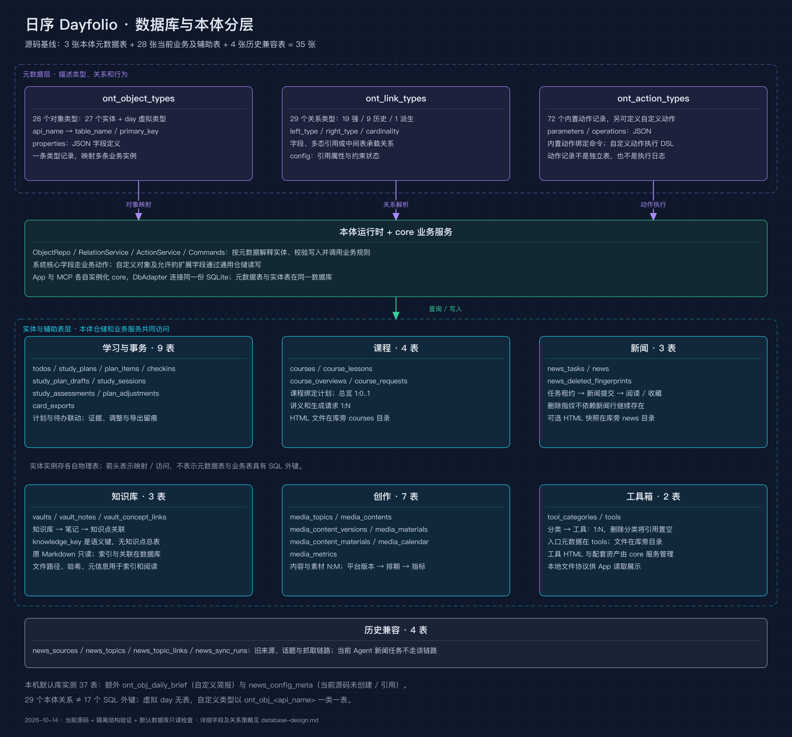
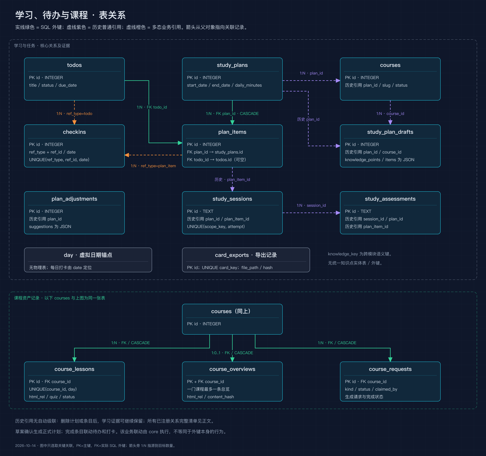
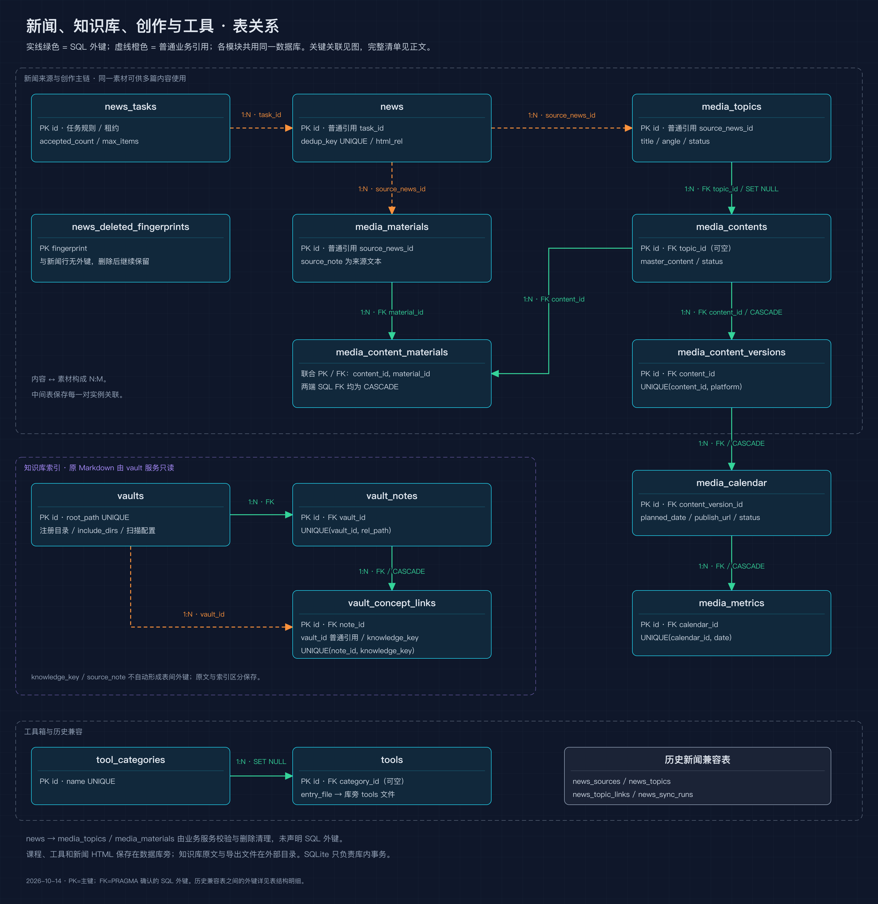

# Dayfolio 数据库与本体设计

核对日期：2026-10-14（北京时间）。依据为当前工作区 `0.13.0` 源码、隔离初始化数据库，以及本机默认数据库的只读结构检查。文档延续 [数据流架构](data-flow-architecture.md)，重点解释表、对象类型和关系的区别。

## 1. 先看数量：基础本体有 3 张表

| 统计口径 | 数量 | 含义 |
| --- | ---: | --- |
| 基础本体元数据表 | **3** | `ont_object_types`、`ont_link_types`、`ont_action_types` |
| 当前业务与业务辅助表 | **28** | 含队列、审计、导出记录、去重指纹及创作中间表 |
| 源码保留的历史兼容表 | **4** | 旧新闻来源、话题、话题关联、抓取任务 |
| 源码初始化的物理表合计 | **35** | 3 + 28 + 4；不含 SQLite 内部表 |
| 本机默认数据库实际物理表 | **37** | 基线 35 张 + 自定义简报表 1 张 + 残留新闻辅助表 1 张 |
| 源码初始化的对象类型记录 | **28** | 27 个映射物理表的对象类型 + 1 个虚拟类型 `day` |
| 源码初始化的关系类型记录 | **29** | 19 个强关系、9 个历史引用、1 个派生关系 |
| 源码初始化的内置动作记录 | **72** | 公共业务命令的描述记录，不是 72 张表 |
| 源码初始化的 SQLite 外键约束 | **17** | 和本体的 29 个逻辑关系不是同一个口径 |

本机默认数据库 `user_version=13`，有 29 个对象类型、29 个关系类型、72 个动作类型。多出的对象类型对应 `ont_obj_daily_brief`。源码初始化库同样为迁移版本 13。`user_version` 与 App 版本号独立，也不能用它单独判断所有表结构完全一致。

统计通过当前源码的 `createCore()` 在内存数据库初始化后执行 `sqlite_schema` 和 PRAGMA 得到，真实数据库以只读连接检查；没有执行真实库迁移或改写业务记录。这里的“实际库”是本机默认路径 `~/Library/Application Support/tododesk/tododesk.db`，未据此推断正在运行的 App 是否使用隔离路径、安装包版本是否与源码一致。

## 2. 本体、业务表与文件的整体关系



[SVG 源图](database-architecture.svg)

本体是覆盖业务数据的描述与访问层。以待办为例：

```text
ont_object_types 中的一条记录
  api_name = todo
  table_name = todos
  primary_key = id
  properties = JSON 字段定义
                 ↓ 映射
todos 中的多条业务记录
  id / title / priority / status / due_date / …
```

系统没有用一张统一的 `objects` 表保存所有业务实例，也没有用通用的 `properties` 表逐条存属性值。待办、计划、课程等有各自的实体表；本体负责解释这些表、提供统一查询和动作入口。自定义类型同样采用一类一张物理表。

## 3. 三张基础本体表各存什么

| 表 | 主要字段 | 作用 |
| --- | --- | --- |
| `ont_object_types` | `api_name`、`table_name`、`primary_key`、`title_property`、`properties`、`is_system`、`is_virtual`、`status` | 定义对象如何映射实体表，哪些字段可读写，如何展示和查询 |
| `ont_link_types` | `left_type`、`right_type`、`cardinality`、`fk_column`、`ref_column`、`discriminator_*`、`link_table`、`backing_*`、`on_delete`、`config` | 定义对象之间的关系、关联字段或中间表、删除与约束策略 |
| `ont_action_types` | `api_name`、`parameters`、`operations`、`is_builtin`、`status` | 定义动作参数、内置业务命令或自定义 DSL 操作 |

三张表都以 `api_name` 为主键；`ont_object_types.table_name` 还具有唯一约束。`properties`、`parameters`、`operations`、`config` 是 SQLite `TEXT` 中的 JSON，而不是额外的属性、参数或操作表。

它们之间有逻辑关联，但目前没有 SQL 外键：

- `ont_link_types.left_type/right_type` 引用对象类型的 `api_name`。
- 动作参数或 DSL 操作引用对象类型、关系类型。
- 内置动作的目标对象绑定、允许入口由代码中的命令目录补充，未另建动作目标表。
- 注册与初始化时，registry 校验类型、字段、物理表与关系是否一致。

初始化由 `bootstrap.ts`、`catalog.ts` 提供系统对象与关系，`commands.ts` 提供内置动作，再同步到元数据表。系统定义以代码为准，同时保留合法用户扩展字段和自定义类型。旧 bootstrap 中的部分动作定义不应单独拿来计数；当前动作初始化以 `COMMAND_DEFS` 为准。

## 4. 业务表按模块分组

下面列出全部 32 张业务及兼容表。主键、全部字段、外键和建表 SQL 见 [表结构明细](database-table-reference.md)；程序可读结构见 [schema 快照](database-schema.json)。

<!-- 表清单由本次结构快照生成 -->
| 模块 | 表 | 主键 | 对象类型 | 用途 |
| --- | --- | --- | --- | --- |
| 待办、计划与打卡 | `todos` | `id` | `todo` | 待办内容、优先级、状态与截止日期 |
| 待办、计划与打卡 | `study_plans` | `id` | `study_plan` | 正式学习计划、日期与每日预算 |
| 待办、计划与打卡 | `plan_items` | `id` | `plan_item` | 计划的每日条目，可关联待办与知识点 |
| 待办、计划与打卡 | `checkins` | `id` | `checkin` | 待办、条目或某日的打卡记录 |
| 学习闭环 | `study_plan_drafts` | `id` | `study_plan_draft` | 草案、知识点与排期 JSON，确认后关联正式计划 |
| 学习闭环 | `study_sessions` | `id` | `study_session` | 实际学习会话、尝试次数、解释与问题 |
| 学习闭环 | `study_assessments` | `id` | `study_assessment` | 测评题目、原答案、评分与证据 |
| 学习闭环 | `plan_adjustments` | `id` | `plan_adjustment` | 计划调整审计，suggestions 为 JSON |
| 学习闭环 | `card_exports` | `id` | `card_export` | 卡片导出幂等键、路径和内容哈希 |
| 课程 | `courses` | `id` | `course` | 课程元数据、计划绑定、样课确认状态 |
| 课程 | `course_lessons` | `id` | `course_lesson` | 每日讲义路径、自测和阅读状态 |
| 课程 | `course_overviews` | `course_id` | `course_overview` | 课程总览文件路径，一门课程最多一条 |
| 课程 | `course_requests` | `id` | `course_request` | 课程生成请求、认领和完成状态 |
| 新闻任务 | `news_tasks` | `id` | `news_task` | 新闻任务规则、租约、累计收录预算 |
| 新闻任务 | `news` | `id` | `news_item` | 新闻摘要、来源、阅读收藏状态和快照路径 |
| 新闻任务 | `news_deleted_fingerprints` | `fingerprint` | 未独立注册 | 删除后的去重指纹，防止新闻重新回流 |
| 工具箱 | `tool_categories` | `id` | `tool_category` | 工具分类 |
| 工具箱 | `tools` | `id` | `tool` | 工具元数据、入口文件与分类 |
| 知识库 | `vaults` | `id` | `vault` | 知识库注册目录与扫描配置 |
| 知识库 | `vault_notes` | `id` | `vault_note` | 笔记索引、元信息、缓存与搜索文本 |
| 知识库 | `vault_concept_links` | `id` | `vault_concept_link` | 知识点语义键与笔记的关联 |
| 创作 | `media_topics` | `id` | `media_topic` | 创作选题与来源 |
| 创作 | `media_contents` | `id` | `media_content` | 母稿、选题绑定与复盘 |
| 创作 | `media_content_versions` | `id` | `media_content_version` | 平台版本、正文与审核状态 |
| 创作 | `media_materials` | `id` | `media_material` | 素材正文与来源引用 |
| 创作 | `media_content_materials` | `content_id, material_id` | 未独立注册 | 内容与素材的多对多中间表 |
| 创作 | `media_calendar` | `id` | `media_calendar_entry` | 发布排期、状态与结果链接 |
| 创作 | `media_metrics` | `id` | `media_metric` | 排期对应的传播指标和自定义 JSON |
| 历史新闻兼容 | `news_sources` | `id` | 未独立注册 | 旧新闻来源配置，历史兼容 |
| 历史新闻兼容 | `news_topics` | `id` | `news_topic` | 旧来源下的采集话题，历史兼容 |
| 历史新闻兼容 | `news_topic_links` | `news_id, topic_id` | 未独立注册 | 历史新闻与话题的中间表 |
| 历史新闻兼容 | `news_sync_runs` | `id` | 未独立注册 | 旧抓取任务和同步结果，历史兼容 |

当前 27 个实体对象类型只覆盖这 32 张表中的一部分：`news_deleted_fingerprints`、`news_sources`、`news_sync_runs`、`news_topic_links`、`media_content_materials` 没有各自的内置对象类型。创作中间表仍用于已注册的多对多关系；未注册不代表表不存在。

虚拟对象 `day` 没有物理表。今日概览和掌握度等汇总也由查询与计算产生，并未分别建 `today` 或 `mastery` 表。知识点依赖、课程 quiz、标签等部分结构保存在 JSON 字段中，并不是每个概念都对应独立实体表。

## 5. 表之间的关系有四种承载方式

### 5.1 SQL 外键

例如 `plan_items.plan_id → study_plans.id` 使用 `ON DELETE CASCADE`；`plan_items.todo_id → todos.id` 使用 `ON DELETE SET NULL`。数据库在启用 `foreign_keys` 后维护这些约束。

关系图中的 **FK** 表示 `PRAGMA foreign_key_list` 确实能查到该约束；字段名带 `_id` 或元数据叫 `fk_column` 都不足以证明 SQL 外键存在。

### 5.2 服务维护的普通字段引用

例如 `news.task_id → news_tasks.id`、创作素材的 `source_news_id → news.id`，当前 DDL 没有为这些字段声明 SQL 外键。core 的写入口和服务进行存在性校验、状态检查及清理。

本体将部分此类引用标为 `strong`；这个标识表达业务关系要求，不保证它已经落成 SQL 外键。真实存在的 SQL 外键仍需看表结构。

### 5.3 多态引用和历史引用

- `checkins` 用 `ref_type + ref_id` 分别关联待办、计划条目或每日打卡。SQLite 不能把同一 `ref_id` 同时声明为指向不同表的外键，因此 core 负责校验目标存在与删除清理。每日打卡的日期锚点来自 `date`，常用 `ref_id=0`，不是指向一张 `days` 表。
- 学习会话、测评、草案、课程绑定、调整记录使用 `plan_id`、`plan_item_id`、`session_id` 等普通引用保留历史。注册的 9 个历史关系返回 `onDelete=none`，不会通过本体关系执行器自动级联删除历史证据。计划和条目删除后，历史引用可能指向已不存在对象，读取端可显示目标不存在。

### 5.4 中间表

`media_contents` 和 `media_materials` 的多对多关系由 `media_content_materials(content_id, material_id)` 承载。两列共同构成主键，并分别有级联删除外键；同一组合只能存在一次。`ont_link_types` 只描述这个关系，不保存每一条内容—素材关联。

历史的 `news_topic_links(news_id, topic_id)` 也是中间表，但不属于当前 Agent 新闻任务主链路。

## 6. 学习、待办和课程关系图



[SVG 源图](database-learning-er.svg)

阅读顺序：正式计划 → 计划条目 → 关联待办 / 打卡；草案确认生成计划；学习会话和测评记录证据；课程绑定计划，课程下有讲义、总览和生成请求。

- 计划对条目是 1:N；一个条目可选关联一个待办，同一个待办可被多个条目引用。
- 课程对讲义、生成请求是 1:N，对总览是 1:0..1（总览以 `course_id` 同时作为主键和外键）。
- 会话和测评使用文本 ID；多数业务表使用整数自增 ID。
- `knowledge_key` 是跨学习排期、会话、测评、知识笔记关联的语义标识，没有一张供所有记录外键引用的 `knowledge_points` 表。
- `card_exports` 用 `card_key` 防重复导出并保存文件路径和摘要哈希，没有独立的卡片内容实体表。

图为了可读只画关键关联；所有已注册关系见第 8 节，所有物理外键见表结构明细。

## 7. 新闻、知识库、创作和工具关系图



[SVG 源图](database-content-er.svg)

- 新闻任务认领后接收多条新闻。删除指纹表保存去重指纹，不保存 `news_id` 外键；这样即使新闻行删除也能防回流。
- 创作选题和素材可用 `source_news_id` 引用新闻；删除新闻由服务清空这类来源引用。
- 创作选题 → 母稿 → 平台版本 → 发布排期 → 指标；母稿与素材通过中间表形成 N:M。外部发布 URL 与指标属于记录数据，数据库本身不执行平台发布。
- 一个知识库对应多条笔记索引，笔记对应多个知识点关联。`vault_concept_links.vault_id` 是普通冗余引用，`note_id` 才有声明的 SQL 外键。
- 创作的 `source_note` 是来源文本，知识点关联的 `knowledge_key` 是语义键。它们目前不构成指向 `vault_notes` 或知识点表的 SQL 外键，也未注册相应本体关系。
- 工具分类 → 工具为 1:N；删除分类会将工具的 `category_id` 置空，工具文件继续由资产服务管理。

## 8. 全部已注册本体关系

**强关系 19 个、历史引用 9 个、派生关系 1 个，共 29 个。** 下表使用运行时 registry 返回的关系策略；它与旧 bootstrap 中保留的删除字段可能不同。

`1:N` 指目标可有多条，每条关联源通常为一个或可空；`1:0..1` 指可选总览；`N:M` 通过中间表。FK 表示数据库约束，业务表示普通引用由服务维护，历史表示保留证据引用，多态表示按 `ref_type` 解释 `ref_id`。

| 关系名 | 物理源 → 目标 | 基数 | 承载方式 / 字段 | 引用类型 | 本体删除策略 |
| --- | --- | --- | --- | --- | --- |
| `study_plan__plan_item` | `study_plans` → `plan_items` | 1:N | FK `plan_items.plan_id` | 强关系 | `cascade` |
| `todo__plan_item` | `todos` → `plan_items` | 1:N | FK `plan_items.todo_id` | 强关系 | `set_null` |
| `todo__checkin` | `todos` → `checkins` | 1:N | 多态 `ref_type=todo` + `ref_id` | 强关系 | `由业务服务处理` |
| `plan_item__checkin` | `plan_items` → `checkins` | 1:N | 多态 `ref_type=plan_item` + `ref_id` | 强关系 | `由业务服务处理` |
| `day__checkin` | `day（虚拟）` → `checkins` | 1:N | 多态 `ref_type=day` + `ref_id` | 派生关系 | `none` |
| `tool_category__tool` | `tool_categories` → `tools` | 1:N | FK `tools.category_id` | 强关系 | `set_null` |
| `study_plan__study_session` | `study_plans` → `study_sessions` | 1:N | 历史 `study_sessions.plan_id` | 历史引用 | `none` |
| `study_session__study_assessment` | `study_sessions` → `study_assessments` | 1:N | 历史 `study_assessments.session_id` | 历史引用 | `none` |
| `news_task__news_item` | `news_tasks` → `news` | 1:N | 业务 `news.task_id` | 强关系 | `restrict` |
| `study_plan__course` | `study_plans` → `courses` | 1:N | 历史 `courses.plan_id` | 历史引用 | `none` |
| `course__course_lesson` | `courses` → `course_lessons` | 1:N | FK `course_lessons.course_id` | 强关系 | `cascade` |
| `course__course_overview` | `courses` → `course_overviews` | 1:0..1 | FK `course_overviews.course_id` | 强关系 | `cascade` |
| `course__course_request` | `courses` → `course_requests` | 1:N | FK `course_requests.course_id` | 强关系 | `cascade` |
| `course__study_plan_draft` | `courses` → `study_plan_drafts` | 1:N | 历史 `study_plan_drafts.course_id` | 历史引用 | `none` |
| `study_plan__study_plan_draft` | `study_plans` → `study_plan_drafts` | 1:N | 历史 `study_plan_drafts.plan_id` | 历史引用 | `none` |
| `plan_item__study_session` | `plan_items` → `study_sessions` | 1:N | 历史 `study_sessions.plan_item_id` | 历史引用 | `none` |
| `study_plan__study_assessment` | `study_plans` → `study_assessments` | 1:N | 历史 `study_assessments.plan_id` | 历史引用 | `none` |
| `plan_item__study_assessment` | `plan_items` → `study_assessments` | 1:N | 历史 `study_assessments.plan_item_id` | 历史引用 | `none` |
| `study_plan__plan_adjustment` | `study_plans` → `plan_adjustments` | 1:N | 历史 `plan_adjustments.plan_id` | 历史引用 | `none` |
| `vault__vault_note` | `vaults` → `vault_notes` | 1:N | FK `vault_notes.vault_id` | 强关系 | `cascade` |
| `vault_note__vault_concept_link` | `vault_notes` → `vault_concept_links` | 1:N | FK `vault_concept_links.note_id` | 强关系 | `cascade` |
| `vault__vault_concept_link` | `vaults` → `vault_concept_links` | 1:N | 业务 `vault_concept_links.vault_id` | 强关系 | `cascade` |
| `media_topic__media_content` | `media_topics` → `media_contents` | 1:N | FK `media_contents.topic_id` | 强关系 | `set_null` |
| `media_content__media_content_version` | `media_contents` → `media_content_versions` | 1:N | FK `media_content_versions.content_id` | 强关系 | `cascade` |
| `media_content_version__media_calendar_entry` | `media_content_versions` → `media_calendar` | 1:N | FK `media_calendar.content_version_id` | 强关系 | `cascade` |
| `media_calendar_entry__media_metric` | `media_calendar` → `media_metrics` | 1:N | FK `media_metrics.calendar_id` | 强关系 | `cascade` |
| `news_item__media_topic` | `news` → `media_topics` | 1:N | 业务 `media_topics.source_news_id` | 强关系 | `set_null` |
| `news_item__media_material` | `news` → `media_materials` | 1:N | 业务 `media_materials.source_news_id` | 强关系 | `set_null` |
| `media_content__media_material` | `media_contents` → `media_materials` | N:M | 中间表 `media_content_materials`（两端 FK） | 强关系 | `cascade` |

物理外键还包括旧新闻表关系和创作中间表两端，因此不能用上述关系条数直接推算外键条数。

## 9. 自定义对象和自定义关系如何扩展

创建自定义对象类型时，registry 会：

1. 校验类型名和属性定义。
2. 创建 `ont_obj_<api_name>` 实体表，使用 `id TEXT PRIMARY KEY`，仓储生成 UUID，补充 `created_at/updated_at`。
3. 为用户属性创建真实列，并将定义写入 `ont_object_types.properties`。
4. 配置索引；对象查询和写入通过本体仓储读取类型定义。

整数与布尔映射 `INTEGER`，小数映射 `REAL`，字符串、日期、枚举、JSON 映射 `TEXT`。动态属性列按安全加列约定允许 NULL；属性必填、枚举等要求主要在写入口校验，不能只读 SQL 声明就推断完整业务规则。

创建关系不会无条件多建一张表：

- 一对一 / 一对多：使用右侧对象中已经存在的关联字段；一对一增加唯一约束。
- 多对多：使用已经存在的自定义对象类型作为中间表，指定左右引用字段；当前不会自动生成一个通用边表。
- 动态关系用索引与触发器维护引用、唯一性和删除规则。冲突存量会标记为 `needs_repair` 并阻止相关写入；新增关系有冲突时可以被拒绝。
- 自定义关系不支持级联删除实体；一对多等可采用限制删除或可空字段置空，多对多端点删除清理中间关系记录。系统已有字段和关系通过业务动作维护。

实际库中的 `ont_obj_daily_brief` 是这个机制的例子：字段包括 `brief_date`、`title`、`content`、`source_urls`、`news_ids`、`item_count`、`task_id`、`status` 和时间窗。它没有 SQL 外键，`news_ids` 与 `task_id` 的名称也不会自动建立本体关系；当前 29 个关系类型均来自内置定义。

## 10. 本机实际库与源码基线的差别

| 差别 | 结构 | 解释 |
| --- | --- | --- |
| `ont_obj_daily_brief` | UUID 主键 + 简报日期、正文、来源、新闻 ID 等 | 当前库的用户自定义对象类型；源码新建库不会自动创建 |
| `news_config_meta` | `key TEXT PRIMARY KEY`、`value TEXT NOT NULL` | 实际库的辅助表；当前 core 源码未创建或引用，不计入源码 35 表基线 |
| `news_tasks` 列顺序 | 旧库通过迁移追加 `accepted_count`，新库在初建定义中包含它 | 忽略列顺序后，35 张基线表的列名、SQL 类型、主键、NOT NULL 和默认值与实际库一致 |

这里比较的是结构，不包含待办、新闻正文等业务记录，也不替代全库完整性或业务状态验收。

## 11. 文件资产和数据库的一致性边界

SQLite 保存元数据与状态；以下文件放在库外：

| 资产 | 位置与数据库关联 |
| --- | --- |
| 课程和讲义 HTML | `dirname(db)/courses/<slug>/`；课程、讲义、总览记录保存 slug、相对路径和内容哈希 |
| 工具 HTML 和配套文件 | `dirname(db)/tools/<id>/`；`tools.entry_file` 指向入口 |
| 新闻 HTML 快照 | `dirname(db)/news/<uuid>.html`；`news.content_kind/html_rel` 指向快照 |
| 知识库原笔记 | 用户注册的外部目录，只读；`vault_notes` 保存索引、相对路径、哈希、搜索文本等 |
| 导出卡片 / 创作素材包 | 用户指定目录；导出记录或内容记录用于跟踪 |

因此，仅备份 SQLite 不等于备份全部课程、工具和新闻快照。文件落盘不属于 SQLite 自身的事务范围，资产服务采用暂存、原子替换和补偿清理协调两者。

数据库使用 WAL、外键和 5 秒锁等待；共享事务助手用 `BEGIN IMMEDIATE` 与嵌套保存点。App 与 MCP 使用各自连接访问同一份文件；本体也没有单独的第二份数据库。

## 12. 源码索引与维护

| 内容 | 文件 |
| --- | --- |
| 初始业务建表、事务与连接设置 | [core/db.ts](../packages/core/src/db.ts) |
| 增量迁移、业务表补充 | [migrations.ts](../packages/core/src/migrations.ts) |
| core 组装、数据库默认路径 | [core/index.ts](../packages/core/src/index.ts) |
| 本体 3 表、初始化、结构校验、类型管理 | [registry.ts](../packages/core/src/ontology/registry.ts) |
| 系统对象与关系定义 | [bootstrap.ts](../packages/core/src/ontology/bootstrap.ts)、[catalog.ts](../packages/core/src/ontology/catalog.ts) |
| 公共业务命令、人工入口与写策略 | [commands.ts](../packages/core/src/ontology/commands.ts)、[policy.ts](../packages/core/src/ontology/policy.ts) |
| 自定义表 DDL、对象读写、关系约束、动作 DSL | [ddl.ts](../packages/core/src/ontology/ddl.ts)、[repo.ts](../packages/core/src/ontology/repo.ts)、[relations.ts](../packages/core/src/ontology/relations.ts)、[action.ts](../packages/core/src/ontology/action.ts) |
| 各业务模块规则与文件管理 | [services/](../packages/core/src/services/) |

统计不包含 `sqlite_sequence`、自动索引、视图、触发器和迁移过程中的临时重建表。关系图展示概念与主键关联，不把 SQL 删除策略等同于整个业务删除流程。后续改表或本体定义时，应重新生成结构快照并同步正文、表明细及三张图。
