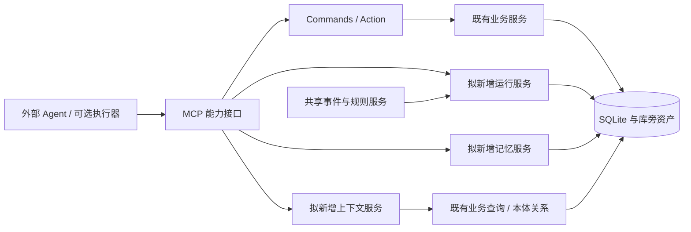

# Dayfolio AI 个人助手能力演进计划

核对日期：2026-10-14（Asia/Shanghai）。状态：规划提案，尚未进入实施。

源码基线：本地工作区根 `package.json` 为 **0.16.0**，HEAD 为 `bfa908f`，包含未提交修改。本文的“已有”仅指本轮读取的源码、README 与帮助文档能够支持的结论；没有验证已安装 App、构建后的 MCP、真实数据库或外部定时任务。阶段编号是计划编号，不对应应用版本号。

配套计划：[Ontology 本体平台演进计划](ontology-platform-roadmap.md)。本文件按用户指定保存到 `docs/plans/`。

## 1. 现状与证据边界

| 能力 | 当前可确认的基础 | 下一步缺口 | 依据 |
| --- | --- | --- | --- |
| 本地业务核心 | Electron 与 stdio MCP 分别实例化同一 core，共享 SQLite 和库旁资产；公共写方法包装为 Commands | 面向 Agent 的统一上下文聚合与运行追踪 | [core/index.ts](../../packages/core/src/index.ts) 中 `createCore`；[Commands](../../packages/core/src/ontology/commands.ts) 中 `wrap`、`execute` |
| Agent 接入 | MCP 提供业务查询、写入、类型发现、对象/关系/Action 工具；有教学工作流资源 | 能力版本发现、输出预算、通用执行记录 | [MCP Server](../../apps/mcp/src/server.ts) 中 `get_study_workflow`、`list_object_types`、`invoke_action` |
| 学习闭环 | 有无日期专题草案、排期预览、确认、学习会话、测评、掌握度和调整；打卡与掌握度分别计算 | 跨计划知识身份、复习效果评估、算法实验 | [study.ts](../../packages/core/src/services/study.ts) 中 `masteryOf`、`suggestAdjustments`；[学习帮助](../../apps/help/docs/09-study-loop.md) |
| 复习 | 固定默认间隔 `[1,3,7,21]`，可传入其他间隔；生成既有计划条目和待办 | 根据真实作答表现选择复习日期 | [review.ts](../../packages/core/src/services/review.ts) 第 17–26 行及 `schedule` |
| 新闻生产 | 外部 Agent 认领、核验、提交、完成；30 分钟租约、每任务累计最多 10 条；App 不负责抓取或唤醒 Agent | 通用任务执行与恢复；新闻规则继续由 news 服务负责 | [news.ts](../../packages/core/src/services/news.ts) 第 22–26 行及 `claimTask`、`submitItems`、`completeTask`；[新闻帮助](../../apps/help/docs/05-news.md) |
| 课程生成 | 样课人工确认、生成请求、Agent 认领与完整包导入已有专用流程 | 通用运行追踪接入；不能假设课程认领已有新闻同款租约 | [course.ts](../../packages/core/src/services/course.ts) 中 `confirmSample`、`claimRequest`、`completeRequest` |
| 知识与创作 | vault 原文只读扫描，SQLite 保存索引与概念关联；创作素材可引用新闻/笔记，导出为文件 | 统一来源引用、跨模块建议与记忆生命周期 | [vault.ts](../../packages/core/src/services/vault.ts)、[media.ts](../../packages/core/src/services/media.ts) |
| 本体与日程 | 自定义对象、关系、声明式 Action 和实例浏览已有；当前日历源码有周/月视图及 MCP 日程 CRUD | 通用模块配置与动态视图；与个人上下文衔接 | [数据帮助](../../apps/help/docs/10-data.md)；[CalendarSection.tsx](../../apps/desktop/src/renderer/src/components/CalendarSection.tsx) 第 40、141–143 行；[日历帮助](../../apps/help/docs/16-calendar.md) |

本轮在 core、MCP 和桌面入口的检索中，未发现独立的个人记忆服务、通用持久化事件队列、通用工作流运行表或 FSRS/BKT 实现，因此这些能力均按**待设计、待建设**处理。既有任务队列不会自行启动外部模型。知识点、标签和部分依赖目前以 JSON 等形式存在，不能把每个概念都当作已经独立注册的本体对象。

[数据流架构](../../doc/data-flow-architecture.md) 与 [数据库设计](../../doc/database-design.md) 提供结构参考，但仍标注 0.13.0；本轮以当前源码核对结果为准。数据库设计中的本机表数量和 `daily_brief` 示例属于旧检查记录，本文没有重新读取真实库，也不据此认定它们为当前默认能力。

## 2. 目标与参考项目

目标是让外部 Agent 在少量上下文中理解用户目标、当前安排、学习证据与相关资料，提出有依据的建议，并通过既有业务写入口完成获准操作。用户可以更换 AI 客户端，长期状态仍留在 Dayfolio。

以下事实只核验官方 README，核对日期同上；没有完成竞品全仓代码审计，也不代表实际运行验收。

| 参考项目 | 官方资料支持的方向 | 对 Dayfolio 的设计启发 |
| --- | --- | --- |
| [Keel](https://github.com/Keel-Labs/keel#what-keel-does) | 本地 Markdown 记忆、按工作区组装上下文、捕获会话成果、周期简报 | 记忆可解释、可导出；围绕业务记录按需取上下文 |
| [Helix](https://github.com/JonJLevesque/Helix#what-it-does) | 记忆与调度分别作为 MCP 能力；定时循环记录状态，强调单次聚焦一个动作 | 分离执行器、业务工具和状态；先建立小型可恢复运行单元 |
| [PersonalOS](https://github.com/amanaiproduct/personal-os#how-it-works) | Backlog 输入、依据目标整理优先级、会话评估和可选 MCP | 收集箱整理与目标关联；建议说明取舍，并记录接受/拒绝反馈 |

这些是借鉴方向。Dayfolio 的权威业务数据继续由 SQLite/core 管理，Markdown 用于导出与知识原文，不新增第二套待办真值源。外部项目文档里的本地部署也不意味着外部模型调用离线。若未来复用上游代码或模板，需单独核验许可；当前只参考产品和架构思路，不复制源码。

### 目标场景

1. “今天先做什么”：聚合截止日期、日程、学习预算、薄弱知识点与用户目标，给出最多三项建议，每项链接来源和解释理由。
2. “继续上次学习”：返回最近会话、真实测评和待完成条目；缺少证据时显示未知，先生成调整预览。
3. “把这条新闻变成学习素材”：复用已核验新闻、知识笔记与学习专题草案，用户确认后排期。
4. “每天生成简报”：在已配置外部执行器的条件下定时领取工作，结果可回读；无人执行时清楚显示等待状态。

## 3. 技术设计（拟新增）

### 3.1 共享架构和写入边界

读查询通过服务、本体元数据和关系接口聚合；系统写入继续通过 Commands。自定义实例使用受限通用 CRUD。学习确认、课程样课确认、创作人工审核沿用各自入口与校验，自动化授权不能代替 `commands.human`。

core 负责规则与持久化，MCP 负责协议与输入归一化；模型会话、联网检索与执行器唤醒放在外部宿主。短期保持外部 Agent 模式。内置模型、语音、全系统控制列为后续独立评估项。

### 3.2 上下文聚合与 MCP 契约

拟新增 `get_personal_context`，接收日期/时间区间、关注对象、包含模块、条数与字符预算；返回 `generated_at`、`schema_revision`、来源对象引用、事实、未知项、截断标记与进一步查询建议。

首版组合 `today`、日历、计划、学习掌握度、最近新闻与 vault 查询。知识正文默认仅取相关摘要，全文显式读取。目标字段先从用户明确表达和计划已有 `goal` 取值；独立 `personal_goal` 对象属于后续新增能力。

输出预算在服务端硬限制，按逾期/时效/目标关联排序；隐去认领令牌、路径中的私人内容与不必提供的字段。请求特定模块时只返回该模块。版本与来源过期时标记，不用旧摘要覆盖当前业务状态。

拟新增能力发现接口，说明工具/动作可用性、输入版本、写模式与人工入口。可先扩展现有类型发现返回，避免并行维护不一致的目录。以上名字均为接口提案，不是已经注册的工具。

### 3.3 个人记忆与目标

由 AI 生成候选，用户能查看、修正、确认、归档和删除。建议由 Ontology 路线登记为受管理系统类型，通过服务与 Commands 写入；业务权限不能被通用对象写入绕过。

| 拟新增数据 | 关键字段与语义 |
| --- | --- |
| `personal_memory` | 主键、分类（偏好/事实/决策/情境）、内容、来源引用、有效期、置信说明、候选/已确认/归档状态、版本 |
| `personal_goal` | 目标、有效时间、优先级、状态、与计划/待办的关系；独立目标尚未在本轮核验入口确认 |
| 记忆修订记录 | 前后版本、修改来源、原因、发生时间；避免只有不可追溯的覆盖 |

长期记忆保存稳定信息，执行日志与新闻正文保留在各自对象中。矛盾事实形成候选修订，不自动覆盖用户确认值。删除记忆同时清理派生索引和上下文缓存；引用源被删除或改变时标为失效并重新评估。

检索先用 SQLite 筛选和已有文本搜索；是否需要 FTS5 在双驱动环境实际验证后决定。向量索引只在关键词检索质量不足时立项，可重建且能禁用。Markdown 导出是单向快照，导回需要独立冲突规则。

### 3.4 可解释规划与学习增强

今日建议先用确定性规则：截止风险、目标关联、可用时间、知识依赖和测评证据，再由 Agent 解释；输出是提案，不直接改排期。收集箱可先采用一个自定义类型试验，进入正式模块后补齐服务/入口/帮助/端到端链路。

学习增强优先补齐知识身份：定义知识 key 的命名空间、跨计划去重和 vault 概念映射。保留客观证据优先、无证据未知、`ai_suggestion` 不计入掌握度的当前规则（[study.ts](../../packages/core/src/services/study.ts) 第 751–766、931–979 行）。

FSRS/BKT 仅列为算法候选。先记录复习结果、难度、用时与知识 key，建立固定间隔基线；随后做影子计算，不影响正式日期。算法版本、数据不足回退、建议理由和撤销范围都需明确。只有评估证明改善、用户接受后才进入正式调度；不能宣称有测评就已经实现自适应模型。

### 3.5 Agent 运行与自动化

拟新增 `agent_run` / `agent_run_step`，记录工作类型、输入快照、授权范围、动作引用、产物引用、错误、次数与时间；状态可为 pending、claimed、running、waiting_review、succeeded、failed、cancelled。

认领用数据库原子更新、租约 token 和截止时间。更新/完成验证 token，超时旧执行者不得提交。每个逻辑运行使用幂等键，每步单独记录重试结果。失败重试仅限瞬时错误，采用退避、次数与总时长上限；校验失败或需人工判断进入等待/失败。用户取消后停止新步骤，已提交结果可见。

先接入新闻专用生命周期与课程请求，不改写两者的业务状态表。运行记录引用它们；新闻仍遵守原租约、时间窗、来源、去重与累计预算。课程认领恢复需另行设计，不能直接套用新闻状态机。

周期定义、事件队列和执行日志共用 Ontology 计划 O3 的事件/规则服务。定时到点只产生一次待执行请求；具备能力的外部宿主负责唤醒。可选本地独立 worker 后续评估：单一调度所有者、睡眠补跑、时区、夏令时、并发、成本与凭证存储均需验收。MCP Server 或 Electron 窗口不能被假定为始终在线。

通知默认只报告有意义的结果、失败或所需人工动作；每日简报按用户选择出结果，空轮询不发提醒。外部发送或发布需要独立授权范围，不能由本地草稿授权推导。

## 4. 阶段里程碑、优先级和验收标准

P0＝后续能力依赖的基础；P1＝形成可用闭环；P2＝有数据后再优化。估时为单人开发粗估，不是承诺，先满足退出条件再进入下一阶段。

| 阶段 | 优先级 / 粗估 | 交付内容 | 依赖 | 退出验收 |
| --- | --- | --- | --- | --- |
| A0 基线与上下文 | P0 / 1–2 周 | 当前能力清单、上下文聚合、MCP 契约 | O0 的写入与元数据边界；既有查询可先开发 | 同一日期同一数据给出一致事实；源对象可追溯；上限截断有标记；隐藏字段不外泄；App/MCP 数据一致 |
| A1 记忆与目标规划 | P1 / 2–3 周 | 记忆候选/确认/修订/删除、目标关联、每日建议与收集箱试验 | A0、O1 身份与关系约定；首版可用现有单跳关系 | 更换客户端能读回确认记忆；冲突不静默覆盖；删除后不再检索到；每项建议都有依据；建议未确认不改日程 |
| A2 可恢复 Agent 运行 | P0 / 2–3 周 | 运行/步骤记录、认领、幂等、重试、人工等待；适配新闻与课程 | A0、O0；只接业务动作 | 两个执行者仅一方获认领；失效 token 拒绝提交；中断后重试无重复待办/新闻；人工入口无法被 Agent 代确认 |
| A3 跨模块学习闭环 | P1 / 2–4 周 | 新闻/笔记到专题草案、知识身份、学习复盘与调整建议 | A1、O1；显示方式可复用已有面板 | 来源可回读；重复素材不重复建专题；无测评仍为未知；调整预览后源状态变化须重新校验；固定复习基线可回归 |
| A4 周期与事件自动化 | P1 / 2–4 周 | 简报/周复盘模板、用户授权范围、运行面板与可选调度适配器 | A2、O3 共用事件服务；运行面板可复用 O2 视图 | 离线/无人执行显示待执行；睡眠恢复不重复；取消后不再派新步骤；重试不突破新闻预算；失败/产物可追溯 |
| A5 检索与学习算法实验 | P2 / 2–4 周试验 | 检索评估、向量候选、动态复习影子计算 | A3 与足够真实复习记录 | 固定评估集对比基线；按来源区分证据；未达质量门槛保持旧方案；禁用后基础功能仍可用 |

建议首个迭代只交付 A0：让 Agent 能准确知道现状。A2 可在 A0 后与 A1 顺序穿插；A4 必须等 O3，不提前再造规则引擎。尚未选择内置 LLM 或算法库，因此时间不含大规模模型运行时建设。

### 跨阶段质量门槛

- 上下文评估：固定 20 个脱敏场景，来源存在且引用正确率 100%；关键遗漏最多 1 个场景；错误权限/敏感字段暴露为零。这是拟定门槛，不是本轮测试结果。
- 性能评估：在明确记录的硬件与 1 万条业务记录夹具下，上下文只读查询 p95 目标低于 500ms，执行 30 次；网络与模型耗时另记。未达标先定位查询与预算。
- 一致性：双进程认领、重复提交、崩溃恢复、动作停用、人工边界与资产失败恢复必须有针对性测试。
- 正式功能完成遵循仓库“四件套”：core、App/IPC、MCP、帮助/端到端；更新帮助后运行 `npm run help:sync`，再按 AGENTS 完成测试、类型检查、隔离验收、版本与发版记录、打包及实际安装验收。本文仅新增计划文档，不触发应用交付。

## 5. 与 Ontology 路线的相互依赖

| 共用能力 | 唯一建设责任 | AI 侧消费方式 |
| --- | --- | --- |
| 类型、字段、身份、关系、修订契约 | O0/O1 | 上下文来源引用、记忆与目标模型、知识 key 映射 |
| 动态表单/视图/模块导航 | O2 | 记忆审核、目标和运行面板可复用组件 |
| Action 与写入策略 | 既有 Commands，由 O0/O3 扩展契约 | A2 每步调用白名单动作，保留业务副作用 |
| 持久化事件、规则、周期定义 | O3 | A4 把规则产出的工作交给外部 Agent |
| Agent 认领、日志、重试 | A2 | O3/O4 引用同一运行记录，不另建执行系统 |
| 本体变更提案与自然语言生成 | O4，消费 A0/A2 | A0 提供发现，A2 记录运行；AI 生成配置仍由 O4 校验与提交 |

不存在互相等待的起点：O0 与 A0 可先完成；O1 后推进 A1/A3；A2 与 O2 可独立推进；O3 同时消费 A2 的执行能力；O4 最后组合已有能力。

## 6. 风险与处理

| 风险 | 处理与触发条件 |
| --- | --- |
| AI 把摘要或自评当事实 | 记录来源、状态和有效期；保留当前测评优先级；来源缺失时标记未知 |
| 长期记忆污染、泄露或删不干净 | 候选确认、修订日志、模块选择与字段过滤；删除必须覆盖派生索引和缓存 |
| App/MCP 并发导致重复工作 | 共享原子认领、幂等键与短事务；网络和模型调用移出写事务 |
| 外部宿主未配置、离线、配额耗尽 | 显示等待/失败原因；保持本地数据可读写；执行器可替换 |
| 联动扩大授权或循环触发 | 规则动作白名单、链路去重与跳数限制；人工门不降级 |
| 文件和数据库无法共同回滚 | 延续课程/工具/新闻资产恢复机制；记录部分失败，重新读取实际产物后重试 |
| 学习算法样本少或指标失真 | 先建固定规则基线；影子模式、版本化和回退；不以打卡率代替学习质量 |
| 工作区改动使计划过时 | 实施前重新读取源码与能力目录；确认新增 API/类型名无冲突，重估阶段范围 |

## 7. 实施前需要确定的选择

记忆默认有效期与保留策略、目标是否独立系统模块、支持哪些外部执行宿主、自动化允许的动作范围、学习实验数据量与衡量方法，需要在各阶段设计评审中确定。当前计划默认：本地 SQLite 为真值源、外部 Agent 执行、规则先行、用户能查看并撤回授权、可选索引可重建。

首个实施包应从 A0 的上下文接口与脱敏场景验收开始；本计划没有修改应用功能或运行时数据。
