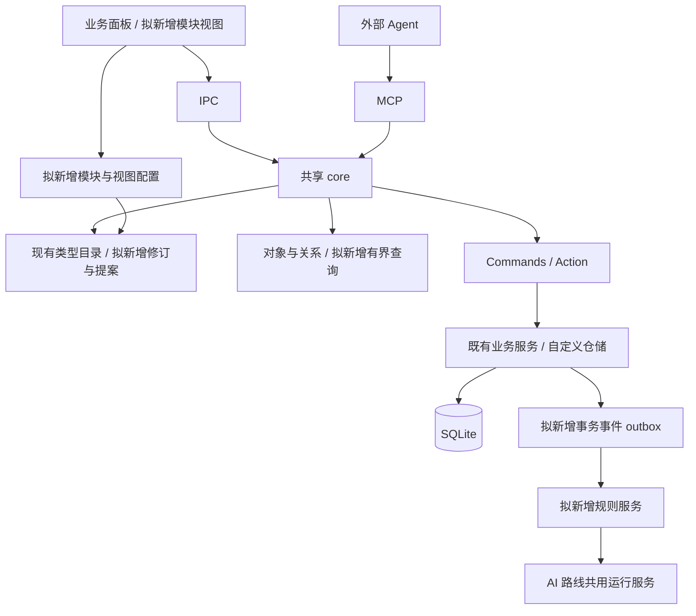
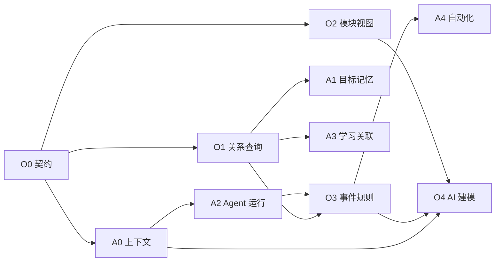

# Dayfolio Ontology 本体平台演进计划

核对日期：2026-10-14（Asia/Shanghai）。状态：规划提案，尚未进入实施。

源码基线：当前本地工作区根 `package.json` 为 **0.16.0**，HEAD 为 `bfa908f`，包含未提交修改。本文依据 README、架构与数据库文档、帮助文档以及相关实现；“已有”是源码层结论，不代表已安装 App、构建 MCP 或真实库已经验收。拟新增类型、接口和表名均为设计候选。

配套计划：[AI 个人助手能力演进计划](ai-assistant-roadmap.md)。本文件按用户指定保存到 `docs/plans/`。现有 [数据流架构](../../doc/data-flow-architecture.md) 与 [数据库设计](../../doc/database-design.md) 仍标注 0.13.0，实施时需重新核对，不沿用其中数量作为当前硬指标。

## 1. 现状：已有轻量本体，不从零重建

| 能力 | 当前已确认实现 | 待建设边界 | 证据入口 |
| --- | --- | --- | --- |
| 类型目录 | ObjectType、LinkType、ActionType；系统表由 bootstrap/catalog 注册，自定义类型映射 `ont_obj_<apiName>` | 模块配置、统一修订与变更提案 | [types.ts](../../packages/core/src/ontology/types.ts)；[registry.ts](../../packages/core/src/ontology/registry.ts) 中 `createObjectType`、`init` |
| 属性与实例 | 七类属性：string/integer/float/boolean/date/json/enum；类型驱动查询、搜索、分页、排序与 CRUD | 校验表达力、服务端查询限额、可保存查询 | [repo.ts](../../packages/core/src/ontology/repo.ts) 第 13–25、48–78 行；[类型契约](../../packages/core/src/ontology/types.ts) |
| 写模式 | 系统业务对象走动作；自定义对象可通用写；允许的系统用户扩展字段可单独改；虚拟/只读受限制 | 新服务/新配置必须沿用同一策略 | [policy.ts](../../packages/core/src/ontology/policy.ts) 中 `objectPolicy`、`assertObjectWrite` |
| 关系 | 1:1/1:N 用右侧已有引用字段；N:M 用已有自定义中间对象；双向分页、幂等建立/解除、目标存在性与唯一约束 | 有界跨关系查询、跨模块关联体验 | [relations.ts](../../packages/core/src/ontology/relations.ts) 第 18–50、64–100 行；[registry.ts](../../packages/core/src/ontology/registry.ts) 中 `createLinkType` |
| Action | 内置动作转 Commands；DSL 支持创建/修改/删除对象和建立/删除链接，值映射为参数/字面量/now/uuid，单数据库事务执行 | 预览、运行历史、受限组合业务命令 | [action.ts](../../packages/core/src/ontology/action.ts) 第 1–3、83–142 行 |
| 通用界面与 MCP | 类型管理、实例表格/详情、关系浏览、参数驱动动作表单；AI 可调用类型/对象/关系/动作工具 | 独立自定义模块导航、视图配置持久化、模块整体提案 | [数据帮助](../../apps/help/docs/10-data.md)；[DataObjects.tsx](../../apps/desktop/src/renderer/src/components/DataObjects.tsx)；[MCP Server](../../apps/mcp/src/server.ts) 第 1228–1555 行 |
| 迁移与维护 | `PRAGMA user_version` 驱动代码迁移；registry 操作包含 DDL/元数据事务校验；App 有数据库备份、JSON 导出与体检 | 自定义 Schema 版本、影响预览、恢复演练；JSON 导出不等于完整可恢复备份 | [migrations.ts](../../packages/core/src/migrations.ts)；[registry.ts](../../packages/core/src/ontology/registry.ts) 第 459–553 行；[data-ipc.ts](../../apps/desktop/src/main/data-ipc.ts) |

关键限制已由源码确认：系统类型只能追加允许的可空扩展字段；只读类型不能靠扩展字段变成可写。1:1/1:N 的右侧可使用自定义对象字段，或系统对象允许的用户扩展字段；系统内置关联字段受保护。N:M 中间表必须是自定义对象类型；虚拟对象不支持用户关系。自反关系当前仅支持 N:M。自定义关系不支持级联删除对端实体；历史引用可以保留目标已删除的情况，不能一律“修复”为强外键。

当前查询条件以单对象类型的 `eq/ne/like/in/gte/lte` 为主，关系列表是专用分页读取；不能宣称已有通用图查询引擎。当前 DSL 没有任意脚本、条件循环或子步骤输出引用，也不能借通用 CRUD 改写系统业务字段。

本轮未在已查看的 core/MCP/桌面入口发现通用模块定义、可配置看板/日历视图存储、持久化事件与规则引擎、完整 Schema 变更提案系统，均列为后续建设。AI 逐个创建类型已经有工具基础，但“自然语言生成一整个可审查模块”仍需新增能力。

## 2. 目标与模型分层

让用户创建读书、训练、项目等个人模块时，通过对象、关系、视图、动作与规则配置获得可用界面和 Agent 能力；通过既有待办、学习、课程、新闻和日程服务进行联动。

“统一 Ontology”是统一描述、发现、引用、查询与操作契约。现有业务表和服务保留其规则；每个业务概念是否成为独立对象要依据身份、关系和生命周期判断。模块是组织入口，视图是展示配置，Action 是可执行行为，不能都当成同一种对象 Schema。

| 层次 | 定义 | 规划例子 |
| --- | --- | --- |
| Schema | 对象/属性/关系/动作定义与修订 | `reading_entry`、书籍关联、记录阅读动作 |
| 实例 | 根据对象定义持久化的记录 | 一次阅读、一本书、一条待办 |
| 模块 | 类型、视图、可用动作与导航组合 | 读书管理 |
| 视图 | 字段、筛选、排序、分组和日期映射 | 阅读列表、阅读状态看板 |
| 规则与运行 | 触发条件、授权动作、执行记录 | 阅读完成后生成待办建议及其运行结果 |

## 3. 技术设计（拟新增）

### 3.1 继续使用现有 core 与权威写入口

App 与 MCP 各自连接同一 SQLite，不另起远程本体服务。内置服务的业务字段通过 Commands/内置 Action 修改；自定义仓储继续执行策略与关系检查。LLM、联网或文件生成不在 SQLite 长事务中执行。

统一对象引用拟为 `{ objectType, id }`，保留实际主键类型，不把所有主键强制转换为整数或字符串。知识点目前部分保存在 JSON 中，先约定稳定 key/命名空间，再决定是否新增独立对象与迁移。

### 3.2 Schema 修订和变更提案

拟新增 `ontology_revision`、`ontology_change_proposal`、`ontology_change_log`，与应用版本及 `PRAGMA user_version` 分开。记录基线修订、操作列表、依赖、影响数量、校验结果、确认范围和提交结果。

流程：读目录 → 生成提案 → 服务端只读预览 → 展示影响 → 确认 → 事务内重校验 → 应用 → 登记新修订。提交携带基线修订，过期即拒绝，需重新预览。预览校验命名/字段/引用/基数、已有数据冲突、动作权限、模块与规则引用以及删除影响。

首版只支持当前安全操作与新增模块/视图：建自定义类型、加兼容可空列、建关系/动作；删列和删类型单列为破坏性操作，显示数据量与所有引用，先确认备份。字段改名、改类型、缩小枚举或非空升级需要后续专门迁移策略，不能绕过当前 registry 限制。

新增前保存可恢复备份的路径与校验摘要。纯 SQLite DDL/元数据可在现有 `inTx` 事务中应用；文件资产和外部副作用采取分步恢复。提交后的“撤销”不是通用事务回滚：无数据影响的配置可生成逆向提案；删除数据等不可逆变更需要按停止写入、备份恢复流程处理。

运行时提案只能修改允许的用户配置。系统 Schema 与命令输入合同仍由代码与迁移定义，[命令输入生成脚本](../../scripts/generate-command-inputs.cjs) 在构建期同步，不能让 AI 动态改写生成代码。

### 3.3 用户模块与动态视图

拟新增 `module_definition` 和 `view_definition`，作为受管理配置类型登记到本体。模块记录名称、关联类型、默认视图、导航顺序、动作/规则引用、状态和配置版本。停用模块隐藏入口并停止其规则，默认保留数据。

| 视图 | 配置 | 实现顺序与限制 |
| --- | --- | --- |
| 表格/详情/表单 | 显示字段、顺序、筛选排序、关联选择、动作 | P0，复用 DataObjects 和类型/动作元数据；系统字段用专用动作 |
| 卡片/看板 | 标题、摘要、合法枚举分组、状态修改动作 | P1；只有存在受允许状态写入动作时才允许拖动 |
| 日历 | 开始/结束日期、可选时间字段、全天规则、修改动作 | P1，复用日历展示组件，查询由配置适配；不能复制成第二份日程数据 |
| 关系视图 | 对端类型、方向、展示字段、分页 | P1，先复用单跳关系，随后消费有界查询 |

字段渲染按类型与 nullable/枚举约束生成，不以视图配置代替服务端校验。缺失字段或非法动作引用拒绝发布；旧视图遇到 Schema 变化时显示需修复，并保留上次配置。配置只描述数据与交互，不允许注入脚本或任意 SQL。

现有个人日历周/月视图是专用业务组件；它的存在不意味着任意自定义类型已支持日历。动态表单已有字段/动作生成基础，应渐进提取共享组件。

### 3.4 关系与跨模块查询

继续复用已有 FK/中间对象和约束，不新增重复通用边表。拟新增 `query_related_objects` 或扩展对象查询，首版只允许已注册关系的单跳过滤、受限字段投影和分页；第二版最多两跳，默认上限 100 行，拒绝循环路径与无界展开。准确接口名在实施时决定。

查询编译只使用元数据白名单与参数绑定。连接主键类型需匹配，历史引用缺失返回显式状态，派生关系只读。明确不同关系的强约束/历史/派生性质，不能把所有 `_id` 或 JSON ID 列表自动视为已注册 LinkType。

跨模块关联先用自定义关系的自定义承载对象引用现有系统对象，并验证当前 registry 允许的结构。系统对象核心引用不能直接通过通用关系写入；系统间新增业务绑定需要命令实现。知识 key 到课程/笔记关联先在现有服务中核对身份，重复、歧义和环均需显式处理。

### 3.5 Action、事件与联动规则

现有 DSL 已有五类操作，继续使用。它缺少系统业务命令组合和前步输出引用，因此“写自定义对象并创建待办”当前不能靠 DSL 的 `create_object(todo)` 实现。

拟增加受限 `invoke_command` 操作与步骤结果引用：仅引用公开业务命令，静态检查参数、依赖和循环；人工命令禁止被嵌套或规则调用。纯数据库、标注可组合的命令才允许放入同一事务；课程资产、HTML 文件等涉及文件的命令作为独立可恢复步骤。先补动作影响预览与运行记录，再开放复合操作。

拟新增 `event_outbox`、`automation_rule` 和规则消费记录；Agent 运行使用 AI 路线 A2 的 `agent_run`，不另建一套执行日志。事件包含 event_id、对象引用、事件类型、必要变更字段、源动作、correlation_id、causation_id、发生时间与 Schema 修订，排除令牌/正文等不必要载荷。

**生产与消费约定：**业务写入和 outbox 插入同事务；写回滚无事件。外层事务成功后消费者再读取。App/MCP 两端均从 core 产生事件；自定义仓储与关系操作也需覆盖。消费者独立认领；至少一次投递，通过 `(rule_id, rule_revision, event_id)` 去重，而不是宣称天然恰好一次。

规则首版只有对象创建/字段变更/关系变更与周期触发、白名单条件、一个动作；随后扩展有限步骤。动作参数用类型化映射，不 eval、不任意 SQL。限制来源链、跳数、执行次数和预算；同一因果链反复触发时暂停并提示。每次失败记录理由，校验错误不无限重试。

已有待办→打卡、计划→待办等联动保留在业务服务中，不为相同副作用再增加规则。新闻任务的来源核验/租约/累计预算和课程样课确认不迁出专用服务。

周期触发只是产出请求；外部 Agent 负责联网/模型步骤。离线、休眠与未配置执行器显示真实等待状态，补跑需幂等。停用规则/模块或撤回授权阻止新执行；已提交数据保留并显示处理范围。

### 3.6 AI 创建与修改本体

现有 MCP 已能逐项创建类型/关系/动作；拟新增 `preview_ontology_change`、`apply_ontology_change` 和模块配置工具，形成整体可审查提案。

流程：自然语言需求 → 读取现有目录 → 优先复用类型/动作 → 生成符合版本化 JSON 契约的提案 → 服务端预览 → 用户查看字段/关系/界面/副作用 → 确认 → 基线重校验与事务提交 → 创建后读回。

AI 只提交配置意图，不提交 SQL 或修改任意磁盘文件。人类确认不能只是 AI 自填 `confirmed=true`；采用 App 中确认记录/受限授权记录绑定提案摘要、版本与范围。旧摘要、额外操作、变化后的授权范围均拒绝。该通用提案确认不替代课程/创作的专用人工入口。

## 4. 贯穿验收场景：读书模块

拟建 `book`、`reading_entry` 两类自定义对象，reading_entry 含引用 book 的可空字段、日期、时长、心得与状态；注册 1:N 关系。模块包含表格与详情，再加入按状态看板、按日期日历。

首个纵向切片用现有类型/关系/CRUD 验证完整链路。之后新增“完成阅读并生成复习待办”受限组合动作：修改 reading_entry，然后通过 `add_todo` 命令创建待办；记录动作输出与来源关系。需要链接系统 todo 时，可用自定义中间对象记录引用，不能直接修改系统核心列。

规则在该状态变更后生成建议；同一事件重放不会重复创建。AI 一次提出整个模块、关系和视图，用户能看到影响后提交。它是计划中的验收用例，本轮没有创建这些类型或真实记录。

## 5. 阶段里程碑、优先级和验收标准

P0＝架构基础与首个可用切片；P1＝业务联动和扩展体验；P2＝后续规模优化。估时为单人开发粗估，阶段以验收条件退出，不预设发布版本号。

| 阶段 | 优先级 / 粗估 | 交付内容 | 依赖 | 退出验收 |
| --- | --- | --- | --- | --- |
| O0 契约与变更基础 | P0 / 1–2 周 | 当前模型审计、修订号、身份/写模式契约、只读影响预览和提案骨架 | 现有 registry/Commands | 能识别系统/自定义/历史/虚拟；系统写绕过全部拒绝；无效提案不产生表或元数据；过期基线拒绝；现有链路可回归 |
| O1 关系与安全查询 | P0 / 1–2 周 | 单跳关联过滤、统一引用、分页与投影；扩展依赖检查 | O0 | 1:1/1:N/N:M 双向结果一致；孤儿/重复受约束；历史缺失可解释；超限/未知字段/循环路径拒绝；删除检查包括配置引用 |
| O2 自定义模块与视图 | P0 表单表格、P1 看板日历 / 2–3 周 | 模块/视图持久化、导航、复用表单与详情 | O0；关系展示消费 O1 | 不写专用 React 面板即可建读书模块；配置重启仍在；App/MCP 读写同一实例；错误 Schema 显示修复；系统只读状态不能拖动 |
| O3 Action 与事件联动 | P1 / 3–4 周 | 动作预览、受限命令组合、outbox、规则与周期定义 | O0/O1；Agent 执行消费 A2，纯本地动作可先完成 | DB 回滚无事件；同事件重放不重复副作用；并发只有一个有效认领；循环停用；课程/新闻限制不绕过；文件失败可恢复 |
| O4 AI 本体构建器 | P1 / 2–3 周 | 整体模块提案、App 审阅、确认、提交与读回 | O0–O3；A0 能力发现、A2 追踪 | 自然语言读书模块完整闭环；同提案重复提交幂等；基线/授权摘要过期拒绝；AI 不能代确认人工审核；失败无半套 Schema |
| O5 迁移与规模增强 | P2 / 2–4 周试验 | 改名/改类型专项迁移、模板导入导出、最多两跳查询优化 | O1/O4 与真实使用反馈 | 临时旧库含用户字段/自定义关系能迁移；资产备份恢复演练通过；模板重装无重复；未达性能门槛保持单跳 |

首个迭代选 O0 加 O2 的表格/详情纵向切片；已有关系可直接支撑原型。O1 作为查询扩展随后补齐；O3 先做本地动作再接 Agent。一次不要同时引入新图数据库、远程 API 与可编程脚本环境。

### 跨阶段质量门槛

- 建立隔离夹具，覆盖系统表、自定义对象、用户扩展字段、历史孤儿、冲突关系与失效视图。迁移前后核对有效业务记录和资产内容；隔离通过不代替真实安装验收。
- 双驱动/多进程覆盖基线冲突、动作停用、重复提交、事件重放、人工入口保护。破坏性提案必须准确列出影响数据和所有类型/动作/视图/规则引用。
- 目标性能：在记录硬件的 1 万对象、5 万关系夹具中，默认分页关联查询 p95 小于 300ms，执行 30 次；两跳查询超限明确拒绝。这是未来验收目标，本轮没有执行性能测试。
- 新增正式模块遵循仓库“四件套”：core 服务、App/IPC、MCP 工具、帮助及端到端。通用模块通过通用能力完成四条链路，新增内置业务服务仍需专用链路。功能交付后按 AGENTS 同步帮助、测试/类型检查、隔离验收、版本/CHANGELOG、打包与安装核验。

## 6. 与 AI 助手路线的相互依赖

| 能力 | Ontology 路线职责 | AI 路线职责 |
| --- | --- | --- |
| 类型/关系/身份/修订 | O0/O1 定义唯一契约 | A0 消费目录与引用；A1/A3 使用目标、记忆和知识身份 |
| 目标与记忆数据 | 提供登记/策略/关系能力 | A1 拥有业务服务、候选确认、修订和检索语义 |
| 模块与动态视图 | O2 提供共享配置与组件 | 记忆/运行面板按需使用，仍服从各自服务边界 |
| 执行日志/认领/重试 | O3/O4 引用统一运行记录 | A2 负责唯一运行基础设施与外部执行适配 |
| 事件/规则/周期定义 | O3 负责唯一 outbox 与规则语义 | A4 消费待执行工作、外部唤醒、产物与通知 |
| AI 模型生成模块提案 | O4 校验、预览、授权绑定和提交 | A0 提供上下文；A2 追踪提案产生过程 |

O0/A0 提供起点；O2 和 A2 可以分别推进。周期规则与事件执行只建设一次，避免双方都创建 scheduler 或 workflow 表。两份计划的阶段粗估共享工作，不能简单相加当成总工期。

## 7. 风险与处理

| 风险 | 处理策略 |
| --- | --- |
| 本体抽象覆盖掉既有业务规则 | 保留服务/Commands；通用写拒绝系统核心字段；复合动作静态校验与回归 |
| 系统 bootstrap 覆盖用户配置 | 系统定义以代码为准，用户扩展和模块配置独立保留；升级夹具覆盖两者 |
| Schema 改动使视图/规则/动作失效 | 引用依赖索引和修订检查；删改前展示影响；旧配置进入需修复状态 |
| 历史引用被误当坏数据清理 | 引用性质显式化；保留学习证据；不自动级联或删除用户数据 |
| App/MCP 并发发布提案或消费事件 | 基线锁定、短事务、单一有效认领、幂等键；不在事务里跑模型 |
| 模块过度配置造成界面复杂 | 从表格/表单开始，模板预填，紧凑导航与渐进设置；按 PRODUCT/DESIGN 约定审阅 |
| 自定义动作/规则扩大操作权限 | 无任意代码、SQL与文件访问；动作白名单、授权范围、人工入口独立保护 |
| 删除后无法“撤销” | 影响预览、可恢复备份与演练；配置逆向变更和数据恢复分别定义 |
| 过早引入复杂平台设施 | 保留 SQLite 与两端 core；新增设施必须有已验证瓶颈和实际使用场景 |

## 8. 实施前需要确定的选择

模块/视图初版支持范围、Schema 修订粒度、确认记录保留时间、系统命令可组合清单、查询上限、备份资产清单与恢复交互，需要在阶段评审确定。当前默认使用配置驱动、SQLite 持久化、两跳以内查询、声明式动作与短事务事件。

正式实施从 O0 的元数据与变更预览开始，以读书模块完成首个可审查切片；本计划没有创建本体、修改业务数据或安装应用。
